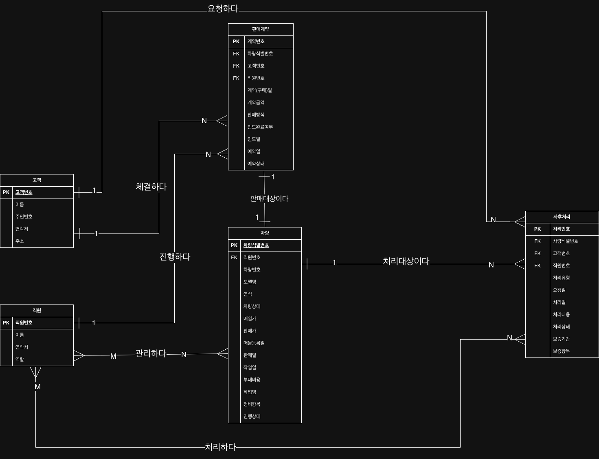

# 논리적 설계

## 1. 최종 선정 릴레이션

개념적 ERD를 기준으로 최종 릴레이션을 선정함.



### 1.1 개체 릴레이션

| No. | 릴레이션명 | 기본키 | 주요 속성 |
| --- | --- | --- | --- |
| 1 | 직원 | 직원번호 | 이름, 연락처, 역할 |
| 2 | 고객 | 고객번호 | 이름, 주민번호, 연락처, 주소 |
| 3 | 차량 | 차량식별번호 | 차량번호, 직원번호, 모델명, 연식, 차량상태, 매입가, 판매가, 매물등록일, 판매일, 작업일, 부대비용, 작업명, 정비항목, 진행상태 |
| 4 | 판매계약 | 계약번호 | 계약(구매)일, 계약금액, 판매방식, 인도완료여부, 인도일, 차량식별번호, 고객번호, 직원번호, 예약일, 예약상태 |
| 5 | 사후처리 | 처리번호 | 처리유형, 요청일, 처리일, 처리내용, 처리상태, 보증기간, 보증항목, 차량식별번호, 고객번호, 직원번호 |

### 1.2 관계 릴레이션

| No. | 릴레이션명 | 관련 릴레이션 | 기본키 |
| --- | --- | --- | --- |
| 1 | 관리하다 | 직원, 차량 | 직원번호(FK), 차량식별번호(FK) |
| 2 | 체결하다 | 고객, 판매계약 | 고객번호(FK), 계약번호(FK) |
| 3 | 판매대상이다 | 차량, 판매계약 | 차량식별번호(FK), 계약번호(FK) |
| 4 | 진행하다 | 직원, 판매계약 | 직원번호(FK), 계약번호(FK) |
| 5 | 처리대상이다 | 차량, 사후처리 | 차량식별번호(FK), 처리번호(FK) |
| 6 | 요청하다 | 고객, 사후처리 | 고객번호(FK), 처리번호(FK) |
| 7 | 처리하다 | 직원, 사후처리 | 직원번호(FK), 처리번호(FK) |


## 2. 개체 타입의 변환

각 개체는 하나의 릴레이션으로 변환함.

- 직원(**<u>직원번호</u>(PK)**, 이름, 연락처, 역할)
- 고객(**<u>고객번호</u>(PK)**, 이름, 주민번호, 연락처, 주소)
- 차량(**<u>차량식별번호</u>(PK)**, 차량번호, **직원번호(FK)**, 모델명, 연식, 차량상태, 매입가, 판매가, 매물등록일, 판매일, 작업일, 부대비용, 작업명, 정비항목, 진행상태)
- 판매계약(**<u>계약번호</u>(PK)**, 계약(구매)일, 계약금액, 판매방식, 인도완료여부, 인도일, **차량식별번호(FK)**, **고객번호(FK)**, **직원번호(FK)**, 예약일, 예약상태)
- 사후처리(**<u>처리번호</u>(PK)**, 처리유형, 요청일, 처리일, 처리내용, 처리상태, 보증기간, 보증항목, **차량식별번호(FK)**, **고객번호(FK)**, **직원번호(FK)**)

## 4. 관계 타입의 변환
### 4.1 1:1

- 판매대상이다(**<u>계약번호(FK)</u>**, **차량식별번호(FK)**)

### 4.2 1:N

- 체결하다(**<u>계약번호(FK)</u>**, **고객번호(FK)**)
- 진행하다(**<u>계약번호(FK)</u>**, **직원번호(FK)**)
- 처리대상이다(**<u>처리번호(FK)</u>**, **차량식별번호(FK)**)
- 요청하다(**<u>처리번호(FK)</u>**, **고객번호(FK)**)

### 4.2 M:N

- 관리하다(**<u>직원번호(FK)**, **차량식별번호(FK)</u>**)
- 처리하다(**<u>직원번호(FK)**, **처리번호(FK)</u>**)

## 5. 릴레이션 단순화

### 5.1 1:1

> 릴레이션 변환
```
차량(<u>차량식별번호</u>, 차량번호, 직원번호(FK), 모델명, ..., 진행상태)
판매계약(<u>계약번호</u>, 고객번호(FK), 직원번호(FK), 계약(구매)일, ..., 예약상태)
판매대상이다(<u>계약번호(FK)</u>, 차량식별번호(FK))
```

> 릴레이션 단순화
```
판매계약(<u>계약번호</u>, 차량식별번호(FK), 고객번호(FK), 직원번호(FK), ..., 예약상태)
차량(<u>차량식별번호</u>, 차량번호, 직원번호(FK), ..., 진행상태)
```

### 5.2 1:N

#### 체결하다 (고객 1:N 판매계약)

> 릴레이션 변환
```
고객(<u>고객번호</u>, 이름, 주민번호, 연락처, 주소)
판매계약(<u>계약번호</u>, 차량식별번호(FK), 직원번호(FK), 계약(구매)일, ..., 예약상태)
체결하다(<u>계약번호(FK)</u>, 고객번호(FK))
```

> 릴레이션 단순화
```
판매계약(<u>계약번호</u>, 차량식별번호(FK), 직원번호(FK), 계약(구매)일, ..., 예약상태, 고객번호(FK))
고객(<u>고객번호</u>, 이름, 주민번호, 연락처, 주소)
```

#### 진행하다 (직원 1:N 판매계약)

> 릴레이션 변환
```
직원(<u>직원번호</u>, 이름, 연락처, 역할)
판매계약(<u>계약번호</u>, 차량식별번호(FK), 고객번호(FK), 계약(구매)일, ..., 예약상태)
진행하다(<u>계약번호(FK)</u>, 직원번호(FK))
```

> 릴레이션 단순화
```
판매계약(<u>계약번호</u>, 차량식별번호(FK), 고객번호(FK), 계약(구매)일, ..., 예약상태, 직원번호(FK))
직원(<u>직원번호</u>, 이름, 연락처, 역할)
```

#### 처리대상이다 (차량 1:N 사후처리)

> 릴레이션 변환
```
차량(<u>차량식별번호</u>, 차량번호, 직원번호(FK), 모델명, ..., 진행상태)
사후처리(<u>처리번호</u>, 고객번호(FK), 직원번호(FK), 처리유형, ..., 보증항목)
처리대상이다(<u>처리번호(FK)</u>, 차량식별번호(FK))
```

> 릴레이션 단순화
```
사후처리(<u>처리번호</u>, 고객번호(FK), 직원번호(FK), 처리유형, ..., 보증항목, 차량식별번호(FK))
차량(<u>차량식별번호</u>, 차량번호, 직원번호(FK), 모델명, ..., 진행상태)
```

#### 요청하다 (고객 1:N 사후처리)

> 릴레이션 변환
```
고객(<u>고객번호</u>, 이름, 주민번호, 연락처, 주소)
사후처리(<u>처리번호</u>, 차량식별번호(FK), 직원번호(FK), 처리유형, ..., 보증항목)
요청하다(<u>처리번호(FK)</u>, 고객번호(FK))
```

> 릴레이션 단순화
```
사후처리(<u>처리번호</u>, 차량식별번호(FK), 직원번호(FK), 처리유형, ..., 보증항목, 고객번호(FK))
고객(<u>고객번호</u>, 이름, 주민번호, 연락처, 주소)
```