# 1) 프로젝트 주제 설명
## 1.1) 목적
중고차 판매시스템은 중고차 매장에서 발생하는 차량 등록, 판매, 고객, 정비 및 상품화, 사후관리 업무를 체계적으로 관리하기 위한 데이터베이스 기반 시스템이다.

본 프로젝트의 목적은 중고차 판매 업무 전반의 데이터를 일관성 있게 관리하고, 차량 검색과 판매 처리 과정을 효율화하여 업무 정확성과 편의성을 높이는 데 있다. 또한 소비자가 중고차를 더욱 편리하게 결정하고 구매할 수 있도록 돕는다.

## 1.2) 필요성
중고차 매장은 차량 입고, 정비, 판매, 고객 상담, 계약, 사후관리 업무가 서로 연결되어 있지만 실제 업무에서는 각 정보가 분산되어 관리되기 쉽다. 이 경우 차량 상태 확인, 판매 가능 차량 조회, 계약 이력 확인, 고객별 구매 내역 조회, A/S 및 클레임 처리 과정에서 시간이 오래 걸리고 누락이나 중복 기록이 발생할 수 있다.

특히 중고차는 차량마다 연식, 상태, 매입가, 판매가, 정비비, 부대비용, 판매일 등이 모두 다르기 때문에 단순 목록 관리만으로는 정확한 재고 관리와 수익 파악이 어렵다. 또한 판매가 완료된 이후에도 보증, A/S 요청, 클레임 처리가 이어지므로 차량, 고객, 계약, 사후처리 정보를 하나의 데이터베이스에서 연결해 관리할 필요가 있다.

- 재고 차량이 많아질수록 입고, 정비중, 판매중, 예약중, 판매완료 상태를 명확히 구분해야 한다.
- 차량번호, 모델명, 연식 등 다양한 조건으로 원하는 차량을 빠르게 검색할 수 있어야 한다.
- 매입가, 판매가, 정비비, 세차비, 탁송비 등 비용 정보를 함께 관리하여 차량별 수익을 파악해야 한다.
- 고객 정보와 구매 이력을 저장하여 재상담, 계약 확인, 사후관리 업무에 활용해야 한다.
- 판매 완료 후에도 계약 정보와 차량 이력, 보증 및 A/S 처리 내역을 보관해야 한다.
- 월별 판매량, 차종별 판매량, 평균 판매가격 등 통계 분석을 위해 일관된 데이터 저장 구조가 필요하다.

## 1.3) 기대효과
차량, 판매, 고객, 정비, 사후관리 데이터를 통합적으로 관리하여 정보의 편리성을 높인다. 판매 진행 상황과 차량 상태를 한눈에 파악할 수 있어 업무 효율이 향상되며, 정비 및 상품화 이력과 판매 후 보증·A/S·클레임 처리까지 체계적으로 관리할 수 있어 실무 활용성이 높은 시스템을 구축할 수 있다.

본 시스템은 현실적인 불편을 줄이고, 별도의 전문 지식 없이도 쉽게 사용할 수 있는 실용적인 관리 도구를 제공하는 것을 목표로 한다.

- **매매업자**: 보유 차량 현황, 판매 진행 상황, 고객 정보, 정비 이력, 판매 후 처리 내역까지 한 번에 관리 가능
- **구매자**: 차량 상태와 이력, 보증 및 사후관리 정보를 명확하게 확인할 수 있어 거래의 신뢰성을 높이며, 구매 후에도 지속적이고 체계적인 서비스를 제공받을 수 있음

# 2) 요구 수집 목록
| No. | 제목 | 요구 수집 내용 | 수집 일자 | 정보 제공자 | 수집 담당자 |
| --- | --- | --- | --- | --- | --- |
| 1 | 중고차회사 직원 | 중고차 매매상 운영 전반에 대해 인터뷰함 [첨부1] | 26/3/25 | 김철수 | 곽준오 |
| 2 | 중고차회사 사장 | 업무 내용을 명확히 정의하기 위해 쇼핑몰 대표와 질의, 응답 진행함. [첨부2] | 26/3/25 | 박영 | 곽준오 |
| 3 | 차량 관리 내역 | 차량 등록 및 관리를 위한 정보 항목 정의 | 26/3/25 | 김철수 | 곽준오 |
| 4 | 고객 정보 | 고객 정보 및 차량 예약 관리에 필요한 데이터 항목 정의 | 26/3/25 | 김철수 | 곽준오 |
| 5 | 판매 이력 | 차량 판매 후 거래 기록 관리에 필요한 데이터 항목 정의 | 26/3/25 | 김철수 | 곽준오 |
| 6 | 통계용 데이터 | 월별 판매량, 평균 판매가격 산출을 위해 판매일 | 26/3/25 | 김철수 | 곽준오 |

# 3) 요구 분석 내용
## 업무 영역 분할도


## 데이터 요구 분석 명세서
### 차량 관리

| # | 요구사항 |
| - | -------------------------------------------------------------- |
| 1 | 판매 담당자는 **차량 상태 정보**를 기록해야 한다. 차량 상태는 입고, 정비중, 판매중 중 하나로 관리한다. |
| 2 | 판매 담당자와 고객은 **차량 정보**를 차량번호, 모델명, 연식으로 검색해야 한다. |
| 3 | 시스템은 **차량 상태 정보**를 **판매 완료 차량 정보**와 **현재 재고 차량 정보**와 구분하여 저장해야 한다. |
| 4 | 매입 담당자는 **차량 가격 정보**에 차량의 매입가와 판매가를 기록해야 한다. |
| 5 | 판매 담당자는 **차량 비용 정보**에 정비비, 세차비, 탁송비 등의 추가 비용을 기록해야 한다. |
| 6 | 판매 담당자는 **차량 담당자 정보**를 지정하고 기록해야 한다. |
| 7 | 시스템은 **차량 등록 정보**에 매물 등록일과 판매일을 자동으로 기록해야 한다. |

### 판매 관리

| # | 요구사항 |
| - | ---------------------------------------------------- |
| 1 | 시스템은 **판매계약 정보**와 **차량 인도 정보**를 저장한다. |
| 2 | 판매 담당자는 **판매방식 정보**에 현금, 할부(캐피탈), 카드를 구분하여 기록해야 한다. |
| 3 | 판매 담당자는 **차량 인도 정보**에 차량 인도 완료 여부를 기록해야 한다. |
| 4 | 판매 담당자는 **판매계약 정보**와 **차량 인도 정보**를 조회해야 한다. |

### 고객 관리

| # | 요구사항 |
| - | ---------------------------------------------------------- |
| 1 | 구매자는 **고객 정보**에 이름, 연락처, 주소 등을 등록한다. |
| 2 | 판매 담당자는 **고객 정보** 중 이름, 연락처, 주소를 조회한다. |
| 3 | 판매 담당자는 **고객 관심차량 정보**를 등록하고 조회해야 한다. |
| 4 | 시스템은 **판매계약 정보**를 통해 예약 상태를 관리하여 동일 차량에 구매예약이 중복되지 않도록 해야 한다. |

### 정비 / 상품화

| # | 요구사항 |
| - | ------------------------------------------------------ |
| 1 | 차량관리사는 **차량 정보**에 차량별 주행거리와 주요 점검 결과를 저장해야 한다. |
| 2 | 차량관리사는 **차량 정보**에 성능 점검 기록과 검사 결과를 차량별로 저장해야 한다. |
| 3 | 차량관리사는 **차량**에 정비항목을 등록하고 진행 상태를 기록해야 한다. |
| 4 | 차량관리사는 **차량**에 세차, 광택, 소모품 교체 등의 상품화작업 내역을 기록해야 한다. |

### 사후 관리

| # | 요구사항 |
| - | -------------------------------------------------- |
| 1 | 판매 담당자는 **사후처리 정보**에 판매 후 차량의 보증 기간과 보증 항목을 기록해야 한다. |
| 2 | 고객은 **사후처리 정보**에 차량 구매 후 문의나 A/S 요청을 등록해야 한다. |
| 3 | 사후관리담당자는 **사후처리 정보**에 처리이력을 저장하고 조회해야 한다. |
| 4 | 사후관리담당자는 **사후처리 정보**에 고객 불만과 처리 상태를 기록하고 관리해야 한다. |

## 트랜젝션 요구 분석 명세서
### 최종 선정 개체

| 순번 | 개체명 | 포함 항목 |
| --- | --- | --- |
| 1 | 직원 | 판매 담당자, 매입 담당자, 차량관리사, 사후관리담당자 |
| 2 | 차량 | 차량 상태, 차량 가격, 차량 담당자, 차량 등록, 차량 비용, 정비항목, 상품화작업 |
| 3 | 판매계약 | 판매계약, 판매방식, 차량 인도 |
| 4 | 고객 | 고객, 구매자 |
| 5 | 사후처리 | 보증, A/S 요청, 사후처리이력, 클레임 |

### 개체 타입 선정

> PK : 기본키
> FK : 외래키

| No. | 개체 타입 | 속성 목록 |
| --- | --- | --- |
| 1 | 직원 | **<u>직원번호</u>(PK)**, 이름, 연락처, 역할 |
| 2 | 고객 | **<u>고객번호</u>(PK)**, 이름, 주민번호, 연락처, 주소 |
| 3 | 차량 | **<u>차량식별번호</u>(PK)**, 차량번호, **직원번호(FK)**, 모델명, 연식, 차량상태, 매입가, 판매가, 매물등록일, 판매일, 작업일, 부대비용, 작업명, 정비항목, 진행상태 |
| 4 | 판매계약 | **<u>계약번호</u>(PK)**, 계약(구매)일, 계약금액, 판매방식, 인도완료여부, 인도일, **차량식별번호(FK)**, **고객번호(FK)**, **직원번호(FK)**, 예약일, 예약상태 |
| 5 | 사후처리 | **<u>처리번호</u>(PK)**, 처리유형, 요청일, 처리일, 처리내용, 처리상태, 보증기간, 보증항목, **차량식별번호(FK)**, **고객번호(FK)**, **직원번호(FK)** |

# 4) 개념적 설계 내용
## 4.1) 개체 후보
```
1.판매 담당자 
2.차량 상태 
3.차량 
4.시스템 
5.판매 완료 차량 
6.현재 재고 차량 
7.차량 비용 
8.차량 담당자 
9.차량 등록 
10.판매 계약 
11.차량 인도 
12.판매 방식 
13.매입 담당자 
14.구매자 
15.고객 
16.고객 관심차량 
17.방문이력
18.구매예약 
19.점검기록 
20.성능점검기록 
21.정비항목 
22.차량 관리사 
23.상품화작업 
24.보증
25.A/S요청 
26.사후처리이력
27.사후관리담당자 
28.클레임
```

## 4.2) 개체 후보 검토
**범례**
- O : 독립 개체로 선정
- X : 개체 탈락 (속성 또는 역할로 처리)
- X (→ 개체명에 통합) : 해당 개체의 속성으로 흡수

##### 차량 관리

| 번호 | 개체 후보 | 데이터 수 | 대표 속성 예시 | 비고 | 개체타입 선정 여부 |
| --- | --- | --- | --- | --- | --- |
| 1 | 판매 담당자 | N | 직원번호, 이름, 연락처 | 직원과 동일 | X (→ 직원에 통합) |
| 2 | 차량 상태 | 소수 코드값 | 상태코드, 상태명 | 차량의 속성 | X (→ 차량 속성) |
| 3 | 차량 | N | 차량식별번호, 차량번호, 모델명, 연식, 매입가, 판매가, 등록일 | | O |
| 4 | 시스템 | 1 | 시스템명 | 업무 수행 주체 | X |
| 5 | 판매 완료 차량 | N | 판매일, 판매상태 | 차량의 속성 | X (→ 차량 속성) |
| 6 | 현재 재고 차량 | N | 재고상태, 등록일 | 차량의 속성 | X (→ 차량 속성) |
| 7 | 차량 비용 | N | 정비비, 세차비, 탁송비 | 차량의 속성 | X (→ 차량 속성) |
| 8 | 차량 담당자 | N | 담당직원번호, 배정일 | 차량의 속성 | X (→ 차량 속성) |
| 9 | 차량 등록 | N | 등록일, 판매일 | 차량의 속성 | X (→ 차량 속성) |
| 13 | 매입 담당자 | N | 직원번호, 이름 | 직원과 동일 | X (→ 직원에 통합) |

##### 판매 관리

| 번호 | 개체 후보 | 데이터 수 | 대표 속성 예시 | 비고 | 개체타입 선정 여부 |
| --- | --- | --- | --- | --- | --- |
| 10 | 판매계약 | N | 계약번호, 계약일, 계약금액, 판매방식 | | O |
| 11 | 차량 인도 | N | 인도완료여부, 인도일 | 판매계약의 속성 | X (→ 판매계약에 통합) |
| 12 | 판매 방식 | 소수 코드값 | 방식코드, 방식명 | 판매계약의 속성 | X (→ 판매계약 속성) |

##### 고객 관리

| 번호 | 개체 후보 | 데이터 수 | 대표 속성 예시 | 비고 | 개체타입 선정 여부 |
| --- | --- | --- | --- | --- | --- |
| 14 | 구매자 | N | 고객번호, 이름, 연락처 | 고객과 동일 | X (→ 고객에 통합) |
| 15 | 고객 | N | 고객번호, 이름, 주민번호, 연락처, 주소 | | O |
| 16 | 고객 관심차량 | N | 고객번호, 차량번호, 등록일 | 범위 외 | X |
| 17 | 방문이력 | N | 방문일, 상담내용 | 범위 외 | X |
| 18 | 구매예약 | N | 예약번호, 예약일, 예약상태 | | X (→ 판매계약에 통합) |

##### 정비 및 상품화 관리

| 번호 | 개체 후보 | 데이터 수 | 대표 속성 예시 | 비고 | 개체타입 선정 여부 |
| --- | --- | --- | --- | --- | --- |
| 19 | 점검기록 | N | 점검번호, 주행거리, 점검결과, 점검일 | 범위 외 | X (→ 차량에 통합) |
| 20 | 성능점검기록 | N | 성능점검번호, 검사결과, 검사일 | 범위 외 | X (→ 차량에 통합) |
| 21 | 정비항목 | N | 항목명, 진행상태 | 차량의 상품화 관련 속성 | X (→ 차량에 통합) |
| 22 | 차량 관리사 | N | 직원번호, 이름 | 직원과 동일 | X (→ 직원에 통합) |

##### 사후 관리

| 번호 | 개체 후보 | 데이터 수 | 대표 속성 예시 | 비고 | 개체타입 선정 여부 |
| --- | --- | --- | --- | --- | --- |
| 24 | 보증 | N | 보증기간, 보증항목 | 사후처리의 속성 | X (→ 사후처리에 통합) |
| 25 | A/S 요청 | N | 요청번호, 요청일, 요청내용, 처리상태 | 사후처리의 속성 | X (→ 사후처리에 통합) |
| 26 | 사후처리이력 | N | 처리일, 처리내용, 처리결과 | 사후처리의 속성 | X (→ 사후처리에 통합) |
| 27 | 사후관리 담당자 | N | 직원번호, 이름 | 직원과 동일 | X (→ 직원에 통합) |
| 28 | 클레임 | N | 클레임번호, 불만내용, 처리상태 | 사후처리의 속성 | X (→ 사후처리에 통합) |

#### 최종 선정 개체

| 순번 | 개체명 | 포함 항목 |
| --- | --- | --- |
| 1 | 직원 | 판매 담당자, 매입 담당자, 차량관리사, 사후관리담당자 |
| 2 | 차량 | 차량 상태, 차량 가격, 차량 담당자, 차량 등록, 차량 비용, 정비항목, 상품화작업 |
| 3 | 판매계약 | 판매계약, 판매방식, 차량 인도 |
| 4 | 고객 | 고객, 구매자 |
| 5 | 사후처리 | 보증, A/S 요청, 사후처리이력, 클레임 |

#### 개체 타입 선정

> PK : 기본키
> FK : 외래키

| No. | 개체 타입 | 속성 목록 |
| --- | --- | --- |
| 1 | 직원 | **<u>직원번호</u>(PK)**, 이름, 연락처, 역할 |
| 2 | 고객 | **<u>고객번호</u>(PK)**, 이름, 주민번호, 연락처, 주소 |
| 3 | 차량 | **<u>차량식별번호</u>(PK)**, 차량번호, **직원번호(FK)**, 모델명, 연식, 차량상태, 매입가, 판매가, 매물등록일, 판매일, 작업일, 부대비용, 작업명, 정비항목, 진행상태 |
| 4 | 판매계약 | **<u>계약번호</u>(PK)**, 계약(구매)일, 계약금액, 판매방식, 인도완료여부, 인도일, **차량식별번호(FK)**, **고객번호(FK)**, **직원번호(FK)**, 예약일, 예약상태 |
| 5 | 사후처리 | **<u>처리번호</u>(PK)**, 처리유형, 요청일, 처리일, 처리내용, 처리상태, 보증기간, 보증항목, **차량식별번호(FK)**, **고객번호(FK)**, **직원번호(FK)** |


## 4.3) 관계 명세서

### 관계 후보 식별

| No. | 관계 후보 | 관련된 개체 목록 |
|:---:|---|---|
| 1 | 관리하다 | 직원, 차량 |
| 2 | 체결하다 | 고객, 판매계약 |
| 3 | 판매대상이다 | 차량, 판매계약 |
| 4 | 진행하다 | 직원, 판매계약 |
| 5 | 처리대상이다 | 차량, 사후처리 |
| 6 | 요청하다 | 고객, 사후처리 |
| 7 | 처리하다 | 직원, 사후처리 |

### 관계 후보 검토

| No. | 관계 후보 | 관련된 개체 목록 | 선정여부 |
|:---:|---|---|---|
| 1 | 관리하다 | 직원, 차량 | O |
| 2 | 체결하다 | 고객, 판매계약 | O | 
| 3 | 판매대상이다 | 차량, 판매계약 | O |
| 4 | 진행하다 | 직원, 판매계약 | O |
| 5 | 처리대상이다 | 차량, 사후처리 | O |
| 6 | 요청하다 | 고객, 사후처리 | O |
| 7 | 처리하다 | 직원, 사후처리 | O |

### 관계 타입 선정

| No. | 관계 후보 | 관련된 개체 목록 | 선정여부 | 관계 유형 |
|:---:|---|---|---|---|
| 1 | 관리하다 | 직원, 차량 | O | M:N |
| 2 | 체결하다 | 고객, 판매계약 | O | 1:N |
| 3 | 판매대상이다 | 차량, 판매계약 | O | 1:1 |
| 4 | 진행하다 | 직원, 판매계약 | O | 1:N |
| 5 | 처리대상이다 | 차량, 사후처리 | O | 1:N |
| 6 | 요청하다 | 고객, 사후처리 | O | 1:N |
| 7 | 처리하다 | 직원, 사후처리 | O | M:N |


## 4.4) ER 다이어그램
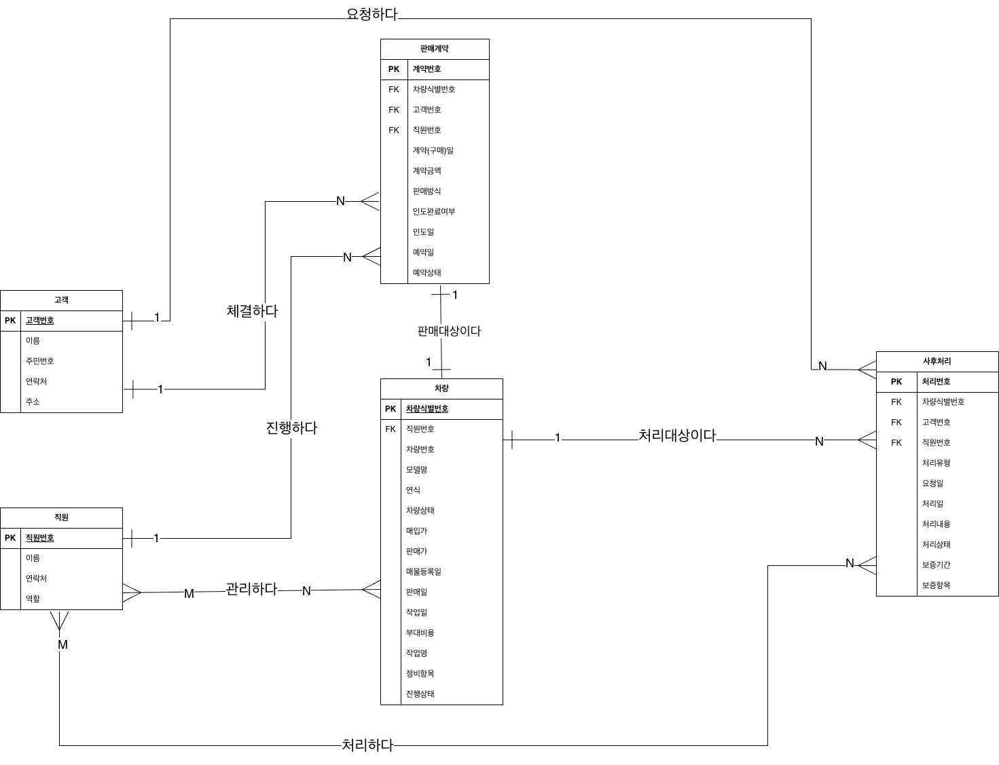

## 4.5) 트랜잭션 모델링
### 1. 차량 관리

| 유형 | 요구 분석 내용 | 입력 | 출력 |
| --- | --- | --- | --- |
| 검색 | 판매 담당자와 고객은 차량을 차량번호, 모델명, 연식으로 검색한다. | 차량번호 모델명 연식 | 차량 |
| 삽입 | 판매 담당자는 차량상태를 기록한다. (입고, 정비중, 판매중) | 차량 | 차량 |
| 삽입 | 매입 담당자는 차량가격에 차량의 매입가와 판매가를 기록한다. | 차량가격 | 차량가격 |
| 삽입 | 판매 담당자는 차량비용에 부대비용등의 추가 비용을 기록한다. | 차량비용 | 차량비용 |
| 삽입 | 시스템은 차량등록에 매물등록일과 판매일을 자동으로 기록한다. | 차량식별번호 | 차량등록 |
| 갱신 | 시스템은 차량상태를 판매 완료 차량과 현재 재고 차량으로 구분하여 저장한다. | 차량식별번호 | 차량 |
| 갱신 | 판매 담당자는 차량담당자를 지정하고 기록한다. | 차량식별번호 차량담당자 | 차량 |

### 2. 판매 관리

| 유형 | 요구 분석 내용 | 입력 | 출력 |
| --- | --- | --- | --- |
| 검색 | 판매 담당자는 판매계약과 차량인도를 조회한다. | 판매계약번호 | 판매계약 차량인도 |
| 삽입 | 시스템은 판매계약과 차량인도를 저장한다. | 판매계약 차량인도 | 판매계약 차량인도 |
| 삽입 | 판매 담당자는 판매방식에 현금, 할부(캐피탈), 카드를 구분하여 기록한다. | 판매방식 | 판매방식 |
| 갱신 | 판매 담당자는 차량인도에 차량 인도 완료 여부를 기록한다. | 인도번호 | 차량인도 |

### 3. 고객 관리

| 유형 | 요구 분석 내용 | 입력 | 출력 |
| --- | --- | --- | --- |
| 검색 | 판매 담당자는 고객 중 이름, 연락처, 주소를 조회한다. | 고객번호 | 고객 |
| 삽입 | 구매자는 고객에 이름, 주민번호, 연락처, 주소 등을 등록한다. | 고객 | 고객 |
| 갱신 | 시스템은 판매계약을 통해 예약 상태를 관리하여 동일 차량에 구매예약이 중복되지 않도록 한다. | 예약번호 차량식별번호 | 판매계약 |

### 4. 정비 및 상품화 관리

| 유형 | 요구 분석 내용 | 입력 | 출력 |
| --- | --- | --- | --- |
| 삽입 | 차량관리사는 차량에 주행거리와 주요 점검 결과를 저장한다. | 차량식별번호 점검결과 | 차량 |
| 삽입 | 차량관리사는 차량에 성능 점검 기록과 검사 결과를 저장한다. | 차량식별번호 검사결과 | 차량 |
| 삽입 | 차량관리사는 차량에 세차, 광택, 소모품 교체 등의 상품화작업 내역을 기록한다. | 차량식별번호 작업내역 | 차량 |
| 혼합 | 차량관리사는 차량에 정비항목을 등록하고 진행 상태를 기록한다. | 차량식별번호 정비항목 | 차량 |

### 5. 사후 관리

| 유형 | 요구 분석 내용 | 입력 | 출력 |
| --- | --- | --- | --- |
| 삽입 | 판매 담당자는 사후처리에 판매 후 차량의 보증 기간과 보증 항목을 기록한다. | 차량식별번호 보증정보 | 사후처리 |
| 삽입 | 고객은 사후처리에 차량 구매 후 문의나 A/S 요청을 등록한다. | 고객번호 A/S요청 | 사후처리 |
| 혼합 | 사후관리담당자는 사후처리에 처리이력을 저장하고 조회한다. | 처리이력 | 사후처리 |
| 혼합 | 사후관리담당자는 사후처리에 고객 불만(클레임)과 처리 상태를 기록하고 관리한다. | 고객번호 클레임 | 사후처리 |

### 운영상의 제약사항
| No. | 제약조건 |
| --- | --- |
| 1 | 차량은 차량식별번호를 기본키로 하여 중복 등록이 허용되지 않는다. |
| 2 | 판매 완료 차량과 현재 재고 차량은 반드시 구분하여 저장되어야 한다. |
| 3 | 매물 등록일과 판매일은 시스템이 자동으로 기록하며, 사용자가 임의로 수정할 수 없다. |
| 4 | 판매계약은 반드시 하나의 차량과 하나의 고객에 대해서만 생성되어야 한다. |
| 5 | 판매방식은 현금, 할부(캐피탈), 카드 중 하나로만 기록되어야 한다. |
| 6 | 차량 인도는 판매계약이 완료된 이후에만 처리할 수 있다. |
| 7 | 동일 차량에 대한 구매예약은 중복으로 등록될 수 없으며, 예약 상태는 시스템이 관리한다. |
| 8 | 점검기록 및 성능점검기록은 반드시 차량이 존재하는 경우에만 저장할 수 있다. |
| 9 | 정비항목의 진행 상태는 등록, 진행중, 완료 중 하나의 값으로만 기록되어야 한다. |
| 10 | 상품화작업은 차량 상태가 정비중인 경우에만 등록할 수 있다. |
| 11 | 성능점검 결과가 등록되지 않은 차량은 판매중 상태로 변경할 수 없다. |
| 12 | 보증은 판매중 차량에 한해서만 등록할 수 있다. |
| 13 | A/S 요청은 보증 기간 내에 있는 차량에 한해서만 등록할 수 있다. |
| 14 | 클레임 처리 상태는 접수, 처리중, 처리완료 중 하나의 값으로만 기록되어야 한다. |
| 15 | 사후처리이력은 반드시 담당자와 함께 기록되어야 하며, 담당자 없이 저장될 수 없다. |

# 5) 논리적 설계 내용
## 5.1) 개체 및 관계 릴레이션 스키마
### 개체 릴레이션 스키마
 - 직원(직원번호, 이름, 연락처, 역할)
 - 차량(차량번호, 모델명, 연식, 차량상태, 매입가, 판매가, 매물등록일, 판매일, 담당직원번호)
 - 판매계약(계약번호, 계약일, 계약금액, 판매방식, 인도완료여부, 인도일, 차량번호, 고객번호, 직원번호, 예약일, 예약상태)
 - 고객(고객번호, 이름, 주민번호, 연락처, 주소)
 - 상품화작업정보(작업번호, 작업명, 작업일, 정비비, 세차비, 탁송비, 차량번호, 직원번호, 항목명, 진행상태)
 - 사후처리(처리번호, 처리유형, 요청일, 처리일, 처리내용, 처리상태, 보증기간, 보증항목, 차량번호, 고객번호)

### 관계 릴레이션 스키마
 - 담당하다(직원번호, 차량번호)
 - 체결하다(고객번호, 계약번호)
 - 계약되다(차량번호, 계약번호)
 - 관리하다(직원번호, 계약번호)
 - 예약하다(고객번호, 계약번호)
 - 예약되다(차량번호, 계약번호)
 - 상품화하다(직원번호, 차량번호)
 - 요청하다(고객번호, 처리번호)
 - 처리하다(직원번호, 처리번호)
 - 기록하다(직원번호, 작업번호)

## 5.2) 단순화한 릴레이션 스키마

### 5.1 1:1

> 릴레이션 변환
```
차량(<u>차량식별번호</u>, 차량번호, 직원번호(FK), 모델명, ..., 진행상태)
판매계약(<u>계약번호</u>, 고객번호(FK), 직원번호(FK), 계약(구매)일, ..., 예약상태)
판매대상이다(<u>계약번호(FK)</u>, 차량식별번호(FK))
```

> 릴레이션 단순화
```
판매계약(<u>계약번호</u>, 차량식별번호(FK), 고객번호(FK), 직원번호(FK), ..., 예약상태)
차량(<u>차량식별번호</u>, 차량번호, 직원번호(FK), ..., 진행상태)
```

### 5.2 1:N

#### 체결하다 (고객 1:N 판매계약)

> 릴레이션 변환
```
고객(<u>고객번호</u>, 이름, 주민번호, 연락처, 주소)
판매계약(<u>계약번호</u>, 차량식별번호(FK), 직원번호(FK), 계약(구매)일, ..., 예약상태)
체결하다(<u>계약번호(FK)</u>, 고객번호(FK))
```

> 릴레이션 단순화
```
판매계약(<u>계약번호</u>, 차량식별번호(FK), 직원번호(FK), 계약(구매)일, ..., 예약상태, 고객번호(FK))
고객(<u>고객번호</u>, 이름, 주민번호, 연락처, 주소)
```

#### 진행하다 (직원 1:N 판매계약)

> 릴레이션 변환
```
직원(<u>직원번호</u>, 이름, 연락처, 역할)
판매계약(<u>계약번호</u>, 차량식별번호(FK), 고객번호(FK), 계약(구매)일, ..., 예약상태)
진행하다(<u>계약번호(FK)</u>, 직원번호(FK))
```

> 릴레이션 단순화
```
판매계약(<u>계약번호</u>, 차량식별번호(FK), 고객번호(FK), 계약(구매)일, ..., 예약상태, 직원번호(FK))
직원(<u>직원번호</u>, 이름, 연락처, 역할)
```

#### 처리대상이다 (차량 1:N 사후처리)

> 릴레이션 변환
```
차량(<u>차량식별번호</u>, 차량번호, 직원번호(FK), 모델명, ..., 진행상태)
사후처리(<u>처리번호</u>, 고객번호(FK), 직원번호(FK), 처리유형, ..., 보증항목)
처리대상이다(<u>처리번호(FK)</u>, 차량식별번호(FK))
```

> 릴레이션 단순화
```
사후처리(<u>처리번호</u>, 고객번호(FK), 직원번호(FK), 처리유형, ..., 보증항목, 차량식별번호(FK))
차량(<u>차량식별번호</u>, 차량번호, 직원번호(FK), 모델명, ..., 진행상태)
```

#### 요청하다 (고객 1:N 사후처리)

> 릴레이션 변환
```
고객(<u>고객번호</u>, 이름, 주민번호, 연락처, 주소)
사후처리(<u>처리번호</u>, 차량식별번호(FK), 직원번호(FK), 처리유형, ..., 보증항목)
요청하다(<u>처리번호(FK)</u>, 고객번호(FK))
```

> 릴레이션 단순화
```
사후처리(<u>처리번호</u>, 차량식별번호(FK), 직원번호(FK), 처리유형, ..., 보증항목, 고객번호(FK))
고객(<u>고객번호</u>, 이름, 주민번호, 연락처, 주소)
```

## 5.3) 정규화 내용

#### 3. 제1정규형
모든 속성은 원자 값을 가져야 한다. 기존 스키마에서 `보증항목`은 여러 값을 가질 수 있으므로 분리한다. (`보증항목` -> `사후처리보증항목`)

변환 과정은 다음과 같다.

```
차량식별번호 -> (차량번호, 직원번호, 모델명, 연식, 차량상태, 매입가, 판매가, 매물등록일, 판매일, 작업일, 부대비용, 작업명, 정비항목, 진행상태)
↓
차량식별번호 -> (차량번호, 직원번호, 모델명, 연식, 차량상태, 매입가, 판매가, 매물등록일, 판매일)
차량작업 -> (작업번호, 차량식별번호, 작업일, 부대비용, 작업명, 정비항목, 진행상태)
```

```
사후처리(처리번호, 차량식별번호, 고객번호, 직원번호, 처리유형, 요청일, 처리일, 처리내용, 처리상태, 보증기간, 보증항목)
↓
사후처리(처리번호, 차량식별번호, 고객번호, 직원번호, 처리유형, 요청일, 처리일, 처리내용, 처리상태, 보증기간)
사후처리보증항목(처리번호, 보증항목)
```

`사후처리보증항목`은 하나의 사후처리 건에서 여러 개가 나올 수 있다. 예를 들어 한 처리 건에 엔진, 미션처럼 여러 보증항목이 같이 들어가면 한 속성 안에 여러 값이 들어가게 된다. 이는 원자 값을 가져야 한다는 제1정규형에 맞지 않으므로 `처리번호`와 `사후처리보증항목`으로 분리한다.

#### 4. 제2정규형

제2정규형은 1NF를 만족하고, 기본키가 아닌 모든 속성이 기본키 전체에 완전 함수 종속되어야 한다.

직원, 고객, 차량, 판매계약, 사후처리는 기본키가 단일 속성이므로 부분 함수 종속이 발생하지 않는다. 관리하다, 처리하다, 사후처리보증항목은 복합키이지만 기본키가 아닌 일반 속성이 없으므로 추가 분해가 필요하지 않다.

따라서 제2정규형을 만족한다.

#### 5. 제3정규형

제3정규형은 2NF를 만족하고, 기본키가 아닌 속성이 기본키에 이행적으로 종속되지 않아야 한다.

각 릴레이션의 함수적 종속을 확인한 결과, 기본키가 아닌 속성이 다른 기본키가 아닌 속성을 결정하는 경우는 없다. 따라서 제3정규형에서 추가 분해는 <u>필요하지 않다.</u>

`직원번호`, `고객번호`, `차량식별번호`, `계약번호`, `처리번호`가 각각 해당 릴레이션의 속성을 직접 결정하므로 이행 종속은 없다. `사후처리보증항목`은 1정규형에서 이미 분리했으므로 그대로 유지한다.

#### 6. 보이스/코드 정규형(BCNF)

BCNF는 모든 함수적 종속에서 결정자가 후보키 또는 슈퍼키여야 한다.

제3정규형까지 진행한 릴레이션은 다음과 같다.

```
직원(직원번호, 이름, 연락처, 역할)
고객(고객번호, 이름, 주민번호, 연락처, 주소)
차량(차량식별번호, 차량번호, 직원번호, 모델명, 연식, 차량상태, 매입가, 판매가, 매물등록일, 판매일, 작업일, 부대비용, 작업명, 정비항목, 진행상태)
차량작업(작업번호, 차량식별번호, 작업일, 부대비용, 작업명, 정비항목, 진행상태)
관리하다(직원번호, 차량식별번호)
판매계약(계약번호, 차량식별번호, 고객번호, 직원번호, 계약(구매)일, 계약금액, 판매방식, 인도완료여부, 인도일, 예약일, 예약상태)
사후처리(처리번호, 차량식별번호, 고객번호, 직원번호, 처리유형, 요청일, 처리일, 처리내용, 처리상태, 보증기간)
처리하다(직원번호, 처리번호)
사후처리보증항목(처리번호, 보증항목)
```

최종 릴레이션의 주요 결정자는 다음과 같다.

```
직원: 직원번호, 연락처
고객: 고객번호, 주민번호
차량: 차량식별번호
차량작업: 작업번호
판매계약: 계약번호, 차량식별번호
사후처리: 처리번호
사후처리보증항목: 처리번호, 보증항목

처리하다: 직원번호, 처리번호
관리하다: 직원번호, 차량식별번호
```

후보키가 아닌 결정자를 가진 함수적 종속은 확인되지 않는다. 위 결정자는 모두 후보키 또는 슈퍼키이므로 BCNF를 만족한다.

## 5.4) 최종 릴레이션 스키마
```
직원(직원번호(PK), 이름, 연락처, 역할)
고객(고객번호(PK), 이름, 주민번호, 연락처, 주소)
차량(차량식별번호(PK), 차량번호, 직원번호(FK), 모델명, 연식, 차량상태, 매입가, 판매가, 매물등록일, 판매일, 작업일, 부대비용, 작업명, 정비항목, 진행상태)
차량작업(작업번호(PK), 차량식별번호(FK), 작업일, 부대비용, 작업명, 정비항목, 진행상태)
관리하다(직원번호(PK, FK), 차량식별번호(PK, FK))
판매계약(계약번호(PK), 차량식별번호(FK), 고객번호(FK), 직원번호(FK), 계약(구매)일, 계약금액, 판매방식, 인도완료여부, 인도일, 예약일, 예약상태)
사후처리(처리번호(PK), 차량식별번호(FK), 고객번호(FK), 직원번호(FK), 처리유형, 요청일, 처리일, 처리내용, 처리상태, 보증기간)
처리하다(직원번호(PK, FK), 처리번호(PK, FK))
사후처리보증항목(처리번호(PK, FK), 보증항목(PK))
```

## 5.5) 무결성 제약조건
| No. | 제약조건 | 제약유형 | 관련 릴레이션 |
|:---:|---|---|---|
| 1 | 이름, 연락처, 직원번호, 역할은 널 값을 가질 수 없다. | NOT NULL | 직원 |
| 2 | 연락처, 직원번호는 유일한 값을 가져야 한다. | UNIQUE | 직원 |
| 3 | 역할은 '판매 담당자', '매입 담당자', '차량관리사', '사후관리담당자' 가운데 하나의 값을 가져야 한다. | CHECK | 직원 |
| 4 | 이름, 주민번호, 연락처, 주소,고객번호는 널 값을 가질 수 없다. | NOT NULL | 고객 |
| 5 | 주민번호, 고객번호는 유일한 값을 가져야 한다. | UNIQUE | 고객 |
| 6 | 고객번호는 'CU' + 숫자 3자리 형식이어야 한다. | CHECK | 고객 |
| 7 | 주민번호는 '######-#*******' 형식이어야 한다. | CHECK | 고객 |
| 8 | 연락처는 'XXX-XXXX-XXXX' 형식이어야 한다. | CHECK | 고객 |
| 9 | 차량식별번호, 차량번호, 모델명, 연식, 차량상태, 매입가, 판매가, 매물등록일, 부대비용는 널 값을 가질 수 없다. | NOT NULL | 차량 |
| 10 | 차량번호, 차량식별번호는 유일한 값을 가져야 한다. | UNIQUE | 차량 |
| 11 | 차량식별번호는 'V' + 숫자 4자리 형식이어야 한다. | CHECK | 차량 |
| 12 | 매입가, 판매가, 부대비용은 0 이상의 값을 가져야 한다. | CHECK | 차량 |
| 13 | 차량상태는 '판매중', '예약중', '판매완료' 가운데 하나의 값을 가져야 한다. | CHECK | 차량 |
| 14 | 정비항목은 '점검', '정비', '세차', '광택', '소모품 교체' 가운데 하나의 값을 가져야 한다. | CHECK | 차량 |
| 15 | 진행상태는 '등록', '진행중', '완료' 가운데 하나의 값을 가져야 한다. | CHECK | 차량 |
| 16 | 계약번호, 차량식별번호, 고객번호, 직원번호, 계약(구매)일, 계약금액, 판매방식, 인도완료여부, 예약상태는 널 값을 가질 수 없다. | NOT NULL | 판매계약 |
| 17 | 계약번호는 'C' + 숫자 4자리 형식이어야 한다. | CHECK | 판매계약 |
| 18 | 계약금액은 0 이상의 값을 가져야 한다. | CHECK | 판매계약 |
| 19 | 판매방식은 '현금', '카드', '할부' 가운데 하나의 값을 가져야 한다. | CHECK | 판매계약 |
| 20 | 인도완료여부는 'Y' 또는 'N' 가운데 하나의 값을 가져야 한다. | CHECK | 판매계약 |
| 21 | 예약상태는 '진행중', '완료', '취소' 가운데 하나의 값을 가져야 한다. | CHECK | 판매계약 |
| 22 | 처리번호, 차량식별번호, 고객번호, 직원번호는 널 값을 가질 수 없다. | NOT NULL | 사후처리 |
| 23 | 처리번호는 'P' + 숫자 4자리 형식이어야 한다. | CHECK | 사후처리 |
| 24 | 처리유형은 '보증', 'A/S', '클레임' 가운데 하나의 값을 가져야 한다. | CHECK | 사후처리 |
| 25 | 처리상태는 '접수', '처리중', '처리완료' 가운데 하나의 값을 가져야 한다. | CHECK | 사후처리 |

# 6) 물리적 설계
## 6.1) 내부 스키마(테이블 형태)

### 직원

| No. | 속성 | 컬럼 이름 | 데이터 타입 | 크기 | NULL 허용 | 키 | 기타 |
| --- | --- | --- | --- | --- | --- | --- | --- |
| 1 | 직원번호 | employee_id | CHAR | 4 | N | PK, UQ | 직원 식별번호, 유일한 값 |
| 2 | 이름 | name | VARCHAR | 20 | N |  | 직원 이름 |
| 3 | 연락처 | phone | CHAR | 13 | N | UQ | 직원 연락처, 유일한 값 |
| 4 | 역할 | role | VARCHAR | 20 | N |  | `판매 담당자`, `매입 담당자`, `차량관리사`, `사후관리담당자` 중 하나 |

### 고객

| No. | 속성 | 컬럼 이름 | 데이터 타입 | 크기 | NULL 허용 | 키 | 기타 |
| --- | --- | --- | --- | --- | --- | --- | --- |
| 1 | 고객번호 | customer_id | CHAR | 5 | N | PK, UQ | `CU` + 숫자 3자리 형식, 유일한 값 |
| 2 | 이름 | name | VARCHAR | 20 | N |  | 고객 이름 |
| 3 | 주민번호 | resident_number | CHAR | 14 | N | UQ | `######-#*******` 형식, 중복 불가 |
| 4 | 연락처 | phone | CHAR | 13 | N |  | `XXX-XXXX-XXXX` 형식 |
| 5 | 주소 | address | VARCHAR | 100 | N |  | 고객 주소 |

### 차량

| No. | 속성 | 컬럼 이름 | 데이터 타입 | 크기 | NULL 허용 | 키 | 기타 |
| --- | --- | --- | --- | --- | --- | --- | --- |
| 1 | 차량식별번호 | vehicle_id | CHAR | 5 | N | PK, UQ | `V` + 숫자 4자리 형식, 유일한 값 |
| 2 | 차량번호 | license_plate | VARCHAR | 10 | N | UQ | 실제 차량번호, 중복 불가 |
| 3 | 직원번호 | employee_id | CHAR | 4 | N | FK | 직원(직원번호) 참조 |
| 4 | 모델명 | model_name | VARCHAR | 30 | N |  | 차량 모델명 |
| 5 | 연식 | model_year | INT | - | N |  | 차량 연식 |
| 6 | 차량상태 | vehicle_status | VARCHAR | 10 | N |  | `판매중`, `예약중`, `판매완료` 중 하나 |
| 7 | 매입가 | purchase_price | INT UNSIGNED | - | N |  | 0 이상의 원화 금액 |
| 8 | 판매가 | sale_price | INT UNSIGNED | - | N |  | 0 이상의 원화 금액 |
| 9 | 매물등록일 | listing_date | DATE | - | N |  | 매물 등록일 |
| 10 | 판매일 | sold_date | DATE | - | Y |  | 판매 전이면 NULL |
| 11 | 작업일 | work_date | DATE | - | Y |  | 상품화 또는 정비 작업일 |
| 12 | 부대비용 | additional_cost | INT UNSIGNED | - | N |  | 0 이상의 원화 금액 |
| 13 | 작업명 | work_name | VARCHAR | 30 | Y |  | 상품화 또는 정비 작업명 |
| 14 | 정비항목 | maintenance_item | VARCHAR | 20 | Y |  | `점검`, `정비`, `세차`, `광택`, `소모품 교체` 중 하나 |
| 15 | 진행상태 | progress_status | VARCHAR | 10 | Y |  | `등록`, `진행중`, `완료` 중 하나 |

### 판매계약

| No. | 속성 | 컬럼 이름 | 데이터 타입 | 크기 | NULL 허용 | 키 | 기타 |
| --- | --- | --- | --- | --- | --- | --- | --- |
| 1 | 계약번호 | contract_id | CHAR | 5 | N | PK | `C` + 숫자 4자리 형식 |
| 2 | 차량식별번호 | vehicle_id | CHAR | 5 | N | FK | 차량(차량식별번호) 참조 |
| 3 | 고객번호 | customer_id | CHAR | 5 | N | FK | 고객(고객번호) 참조 |
| 4 | 직원번호 | employee_id | CHAR | 4 | N | FK | 직원(직원번호) 참조 |
| 5 | 계약(구매)일 | contract_date | DATE | - | N |  | 계약 또는 구매 발생일 |
| 6 | 계약금액 | contract_amount | INT UNSIGNED | - | N |  | 0 이상의 원화 금액 |
| 7 | 판매방식 | payment_method | VARCHAR | 10 | N |  | `현금`, `카드`, `할부` 중 하나 |
| 8 | 인도완료여부 | delivery_completed | CHAR | 1 | N |  | `Y` 또는 `N` |
| 9 | 인도일 | delivery_date | DATE | - | Y |  | 인도 전이면 NULL |
| 10 | 예약일 | reservation_date | DATE | - | Y |  | 예약이 없으면 NULL |
| 11 | 예약상태 | reservation_status | VARCHAR | 10 | N |  | `진행중`, `완료`, `취소` 중 하나 |

### 사후처리

| No. | 속성 | 컬럼 이름 | 데이터 타입 | 크기 | NULL 허용 | 키 | 기타 |
| --- | --- | --- | --- | --- | --- | --- | --- |
| 1 | 처리번호 | service_id | CHAR | 5 | N | PK | `P` + 숫자 4자리 형식 |
| 2 | 차량식별번호 | vehicle_id | CHAR | 5 | N | FK | 차량(차량식별번호) 참조 |
| 3 | 고객번호 | customer_id | CHAR | 5 | N | FK | 고객(고객번호) 참조 |
| 4 | 직원번호 | employee_id | CHAR | 4 | N | FK | 직원(직원번호) 참조 |
| 5 | 처리유형 | service_type | VARCHAR | 10 | Y |  | `보증`, `A/S`, `클레임` 중 하나 |
| 6 | 요청일 | request_date | DATE | - | Y |  | 처리 요청일 |
| 7 | 처리일 | process_date | DATE | - | Y |  | 처리 완료 전이면 NULL |
| 8 | 처리내용 | service_content | VARCHAR | 100 | Y |  | 처리 요청 또는 결과 내용 |
| 9 | 처리상태 | service_status | VARCHAR | 10 | Y |  | `접수`, `처리중`, `처리완료` 중 하나 |
| 10 | 보증기간 | warranty_period | VARCHAR | 10 | Y |  | 보증 없음이면 NULL |
| 11 | 보증항목 | warranty_item | VARCHAR | 50 | Y |  | 보증 없음이면 NULL |

### 관리하다

| No. | 속성 | 컬럼 이름 | 데이터 타입 | 크기 | NULL 허용 | 키 | 기타 |
| --- | --- | --- | --- | --- | --- | --- | --- |
| 1 | 직원번호 | employee_id | CHAR | 4 | N | PK, FK | 직원(직원번호) 참조 |
| 2 | 차량식별번호 | vehicle_id | CHAR | 5 | N | PK, FK | 차량(차량식별번호) 참조 |

### 처리하다

| No. | 속성 | 컬럼 이름 | 데이터 타입 | 크기 | NULL 허용 | 키 | 기타 |
| --- | --- | --- | --- | --- | --- | --- | --- |
| 1 | 직원번호 | employee_id | CHAR | 4 | N | PK, FK | 직원(직원번호) 참조 |
| 2 | 처리번호 | service_id | CHAR | 5 | N | PK, FK | 사후처리(처리번호) 참조 |

## 6.2) 인덱스 정의서

| No. | 릴레이션명 | 속성명 | 테이블명 | 컬럼명 | 인덱스명 | 데이터 타입 | 정렬 |
|:---:|---|---|---|---|---|---|---|
| 1 | 차량 | 차량상태, 매물등록일 | vehicle | vehicle_status, listing_date | vehicle_status_listing_date_idx | VARCHAR(10), DATE | ASC, DESC |
| 2 | 판매계약 | 고객번호, 계약(구매)일 | sales_contract | customer_id, contract_date | customer_contract_date_idx | CHAR(5), DATE | ASC, DESC |
| 3 | 사후처리 | 처리상태, 요청일 | after_service | service_status, request_date | service_status_request_date_idx | VARCHAR(10), DATE | ASC, ASC |

# 7) 테이블 생성·삽입·삭제
## 7.1) 테이블 생성
```sql
CREATE TABLE `직원` (
    employee_id CHAR(4) NOT NULL,
    name VARCHAR(20) NOT NULL,
    phone CHAR(13) NOT NULL,
    role VARCHAR(20) NOT NULL,
    CONSTRAINT employee_pk PRIMARY KEY (employee_id),
    CONSTRAINT employee_phone_uq UNIQUE (phone),
    CONSTRAINT employee_role_ck CHECK (role IN ('판매 담당자', '매입 담당자', '차량관리사', '사후관리담당자'))
);

CREATE TABLE `고객` (
    customer_id CHAR(5) NOT NULL,
    name VARCHAR(20) NOT NULL,
    resident_number CHAR(14) NOT NULL,
    phone CHAR(13) NOT NULL,
    address VARCHAR(100) NOT NULL,
    CONSTRAINT customer_pk PRIMARY KEY (customer_id),
    CONSTRAINT customer_id_uq UNIQUE (customer_id),
    CONSTRAINT customer_resident_number_uq UNIQUE (resident_number),
    CONSTRAINT customer_id_ck CHECK (customer_id REGEXP '^CU[0-9]{3}$'),
    CONSTRAINT customer_resident_number_ck CHECK (resident_number REGEXP '^[0-9]{6}-[0-9][*]{6}$'),
    CONSTRAINT customer_phone_ck CHECK (phone REGEXP '^[0-9]{3}-[0-9]{4}-[0-9]{4}$')
);

CREATE TABLE `차량` (
    vehicle_id CHAR(5) NOT NULL,
    license_plate VARCHAR(10) NOT NULL,
    employee_id CHAR(4) NOT NULL,
    model_name VARCHAR(30) NOT NULL,
    model_year INT NOT NULL,
    vehicle_status VARCHAR(10) NOT NULL,
    purchase_price INT UNSIGNED NOT NULL,
    sale_price INT UNSIGNED NOT NULL,
    listing_date DATE NOT NULL,
    sold_date DATE,
    work_date DATE,
    additional_cost INT UNSIGNED NOT NULL,
    work_name VARCHAR(30),
    maintenance_item VARCHAR(20),
    progress_status VARCHAR(10),
    CONSTRAINT vehicle_pk PRIMARY KEY (vehicle_id),
    CONSTRAINT vehicle_id_uq UNIQUE (vehicle_id),
    CONSTRAINT vehicle_license_plate_uq UNIQUE (license_plate),
    CONSTRAINT vehicle_employee_fk FOREIGN KEY (employee_id) REFERENCES `직원`(employee_id),
    CONSTRAINT vehicle_id_ck CHECK (vehicle_id REGEXP '^V[0-9]{4}$'),
    CONSTRAINT vehicle_price_ck CHECK (purchase_price >= 0 AND sale_price >= 0 AND additional_cost >= 0),
    CONSTRAINT vehicle_status_ck CHECK (vehicle_status IN ('판매중', '예약중', '판매완료')),
    CONSTRAINT vehicle_maintenance_item_ck CHECK (maintenance_item IN ('점검', '정비', '세차', '광택', '소모품 교체')),
    CONSTRAINT vehicle_progress_status_ck CHECK (progress_status IN ('등록', '진행중', '완료'))
);

CREATE TABLE `차량작업` (
    work_id CHAR(5) NOT NULL,
    vehicle_id CHAR(5) NOT NULL,
    work_date DATE,
    additional_cost INT UNSIGNED NOT NULL,
    work_name VARCHAR(30),
    maintenance_item VARCHAR(20),
    progress_status VARCHAR(10),
    CONSTRAINT vehicle_work_pk PRIMARY KEY (work_id),
    CONSTRAINT vehicle_work_vehicle_fk FOREIGN KEY (vehicle_id) REFERENCES `차량`(vehicle_id),
    CONSTRAINT vehicle_work_id_ck CHECK (work_id REGEXP '^W[0-9]{4}$'),
    CONSTRAINT vehicle_work_additional_cost_ck CHECK (additional_cost >= 0),
    CONSTRAINT vehicle_work_maintenance_item_ck CHECK (maintenance_item IN ('점검', '정비', '세차', '광택', '소모품 교체')),
    CONSTRAINT vehicle_work_progress_status_ck CHECK (progress_status IN ('등록', '진행중', '완료'))
);

CREATE TABLE `관리하다` (
    employee_id CHAR(4) NOT NULL,
    vehicle_id CHAR(5) NOT NULL,
    CONSTRAINT manage_vehicle_pk PRIMARY KEY (employee_id, vehicle_id),
    CONSTRAINT manage_vehicle_employee_fk FOREIGN KEY (employee_id) REFERENCES `직원`(employee_id),
    CONSTRAINT manage_vehicle_vehicle_fk FOREIGN KEY (vehicle_id) REFERENCES `차량`(vehicle_id)
);

CREATE TABLE `판매계약` (
    contract_id CHAR(5) NOT NULL,
    vehicle_id CHAR(5) NOT NULL,
    customer_id CHAR(5) NOT NULL,
    employee_id CHAR(4) NOT NULL,
    contract_date DATE NOT NULL,
    contract_amount INT UNSIGNED NOT NULL,
    payment_method VARCHAR(10) NOT NULL,
    delivery_completed CHAR(1) NOT NULL,
    delivery_date DATE,
    reservation_date DATE,
    reservation_status VARCHAR(10) NOT NULL,
    CONSTRAINT sales_contract_pk PRIMARY KEY (contract_id),
    CONSTRAINT sales_contract_vehicle_fk FOREIGN KEY (vehicle_id) REFERENCES `차량`(vehicle_id),
    CONSTRAINT sales_contract_customer_fk FOREIGN KEY (customer_id) REFERENCES `고객`(customer_id),
    CONSTRAINT sales_contract_employee_fk FOREIGN KEY (employee_id) REFERENCES `직원`(employee_id),
    CONSTRAINT sales_contract_id_ck CHECK (contract_id REGEXP '^C[0-9]{4}$'),
    CONSTRAINT sales_contract_amount_ck CHECK (contract_amount >= 0),
    CONSTRAINT sales_contract_payment_method_ck CHECK (payment_method IN ('현금', '카드', '할부')),
    CONSTRAINT sales_contract_delivery_completed_ck CHECK (delivery_completed IN ('Y', 'N')),
    CONSTRAINT sales_contract_reservation_status_ck CHECK (reservation_status IN ('진행중', '완료', '취소'))
);

CREATE TABLE `사후처리` (
    service_id CHAR(5) NOT NULL,
    vehicle_id CHAR(5) NOT NULL,
    customer_id CHAR(5) NOT NULL,
    employee_id CHAR(4) NOT NULL,
    service_type VARCHAR(10),
    request_date DATE,
    process_date DATE,
    service_content VARCHAR(100),
    service_status VARCHAR(10),
    warranty_period VARCHAR(10),
    CONSTRAINT after_service_pk PRIMARY KEY (service_id),
    CONSTRAINT after_service_vehicle_fk FOREIGN KEY (vehicle_id) REFERENCES `차량`(vehicle_id),
    CONSTRAINT after_service_customer_fk FOREIGN KEY (customer_id) REFERENCES `고객`(customer_id),
    CONSTRAINT after_service_employee_fk FOREIGN KEY (employee_id) REFERENCES `직원`(employee_id),
    CONSTRAINT after_service_id_ck CHECK (service_id REGEXP '^P[0-9]{4}$'),
    CONSTRAINT after_service_type_ck CHECK (service_type IN ('보증', 'A/S', '클레임')),
    CONSTRAINT after_service_status_ck CHECK (service_status IN ('접수', '처리중', '처리완료'))
);

CREATE TABLE `처리하다` (
    employee_id CHAR(4) NOT NULL,
    service_id CHAR(5) NOT NULL,
    CONSTRAINT process_service_pk PRIMARY KEY (employee_id, service_id),
    CONSTRAINT process_service_employee_fk FOREIGN KEY (employee_id) REFERENCES `직원`(employee_id),
    CONSTRAINT process_service_after_service_fk FOREIGN KEY (service_id) REFERENCES `사후처리`(service_id)
);

CREATE TABLE `사후처리보증항목` (
    service_id CHAR(5) NOT NULL,
    warranty_item VARCHAR(50) NOT NULL,
    CONSTRAINT after_service_warranty_item_pk PRIMARY KEY (service_id, warranty_item),
    CONSTRAINT after_service_warranty_item_fk FOREIGN KEY (service_id) REFERENCES `사후처리`(service_id)
);
```

## 7.2) 데이터 삽입

```sql
INSERT INTO `직원` (employee_id, name, phone, role) VALUES
('E001', '김민준', '010-1001-0001', '판매 담당자'),
('E002', '이서연', '010-1001-0002', '매입 담당자'),
('E003', '박도윤', '010-1001-0003', '차량관리사'),
('E004', '최지우', '010-1001-0004', '사후관리담당자'),
('E005', '정하준', '010-1001-0005', '판매 담당자'),
('E006', '강서아', '010-1001-0006', '매입 담당자'),
('E007', '윤지호', '010-1001-0007', '차량관리사'),
('E008', '장하린', '010-1001-0008', '사후관리담당자'),
('E009', '임시우', '010-1001-0009', '판매 담당자'),
('E010', '한유나', '010-1001-0010', '차량관리사');

INSERT INTO `고객` (customer_id, name, resident_number, phone, address) VALUES
('CU001', '박지훈', '990101-1******', '010-2001-0001', '서울시 강남구 테헤란로 10'),
('CU002', '최유진', '980505-2******', '010-2001-0002', '서울시 송파구 올림픽로 20'),
('CU003', '이현우', '970312-1******', '010-2001-0003', '서울시 마포구 월드컵북로 30'),
('CU004', '김서윤', '960824-2******', '010-2001-0004', '서울시 성동구 왕십리로 40'),
('CU005', '정민재', '950716-1******', '010-2001-0005', '경기도 성남시 분당구 판교로 50'),
('CU006', '한지민', '940228-2******', '010-2001-0006', '경기도 수원시 영통구 광교로 60'),
('CU007', '오준서', '930909-1******', '010-2001-0007', '인천시 연수구 송도과학로 70'),
('CU008', '신예린', '920411-2******', '010-2001-0008', '부산시 해운대구 센텀로 80'),
('CU009', '유태양', '910621-1******', '010-2001-0009', '대전시 유성구 대학로 90'),
('CU010', '서아름', '900103-2******', '010-2001-0010', '대구시 수성구 달구벌대로 100');

INSERT INTO `차량` (vehicle_id, license_plate, employee_id, model_name, model_year, vehicle_status, purchase_price, sale_price, listing_date, sold_date, work_date, additional_cost, work_name, maintenance_item, progress_status) VALUES
('V0001', '12가3456', 'E002', '아반떼', 2021, '판매완료', 13000000, 15500000, '2026-05-01', '2026-05-20', '2026-05-03', 300000, '기본 상품화', '점검', '완료'),
('V0002', '34나7890', 'E002', '쏘나타', 2020, '판매중', 16000000, 18500000, '2026-05-02', NULL, '2026-05-04', 450000, '외관 정비', '광택', '진행중'),
('V0003', '56다1234', 'E006', 'K5', 2022, '예약중', 19000000, 21500000, '2026-05-03', NULL, '2026-05-05', 250000, '실내 세차', '세차', '완료'),
('V0004', '78라5678', 'E006', '그랜저', 2019, '판매완료', 22000000, 24800000, '2026-05-04', '2026-05-22', '2026-05-06', 600000, '소모품 정비', '소모품 교체', '완료'),
('V0005', '90마1111', 'E002', '스포티지', 2021, '판매중', 21000000, 23500000, '2026-05-05', NULL, '2026-05-07', 350000, '성능 점검', '점검', '완료'),
('V0006', '11바2222', 'E006', '투싼', 2020, '예약중', 20000000, 22600000, '2026-05-06', NULL, '2026-05-08', 400000, '하체 정비', '정비', '진행중'),
('V0007', '22사3333', 'E002', '모닝', 2022, '판매중', 8000000, 9800000, '2026-05-07', NULL, '2026-05-09', 150000, '출고 세차', '세차', '완료'),
('V0008', '33아4444', 'E006', '카니발', 2018, '판매완료', 24000000, 27000000, '2026-05-08', '2026-05-25', '2026-05-10', 700000, '광택 작업', '광택', '완료'),
('V0009', '44자5555', 'E002', '셀토스', 2023, '판매중', 23000000, 25800000, '2026-05-09', NULL, '2026-05-11', 300000, '기본 정비', '정비', '등록'),
('V0010', '55차6666', 'E006', '제네시스 G80', 2021, '예약중', 42000000, 46500000, '2026-05-10', NULL, '2026-05-12', 800000, '프리미엄 상품화', '소모품 교체', '진행중');

INSERT INTO `차량작업` (work_id, vehicle_id, work_date, additional_cost, work_name, maintenance_item, progress_status) VALUES
('W0001', 'V0001', '2026-05-03', 300000, '기본 상품화', '점검', '완료'),
('W0002', 'V0002', '2026-05-04', 450000, '외관 정비', '광택', '진행중'),
('W0003', 'V0003', '2026-05-05', 250000, '실내 세차', '세차', '완료'),
('W0004', 'V0004', '2026-05-06', 600000, '소모품 정비', '소모품 교체', '완료'),
('W0005', 'V0005', '2026-05-07', 350000, '성능 점검', '점검', '완료'),
('W0006', 'V0006', '2026-05-08', 400000, '하체 정비', '정비', '진행중'),
('W0007', 'V0007', '2026-05-09', 150000, '출고 세차', '세차', '완료'),
('W0008', 'V0008', '2026-05-10', 700000, '광택 작업', '광택', '완료'),
('W0009', 'V0009', '2026-05-11', 300000, '기본 정비', '정비', '등록'),
('W0010', 'V0010', '2026-05-12', 800000, '프리미엄 상품화', '소모품 교체', '진행중');

INSERT INTO `관리하다` (employee_id, vehicle_id) VALUES
('E003', 'V0001'),
('E003', 'V0002'),
('E007', 'V0003'),
('E007', 'V0004'),
('E010', 'V0005'),
('E010', 'V0006'),
('E003', 'V0007'),
('E007', 'V0008'),
('E010', 'V0009'),
('E003', 'V0010');

INSERT INTO `판매계약` (contract_id, vehicle_id, customer_id, employee_id, contract_date, contract_amount, payment_method, delivery_completed, delivery_date, reservation_date, reservation_status) VALUES
('C0001', 'V0001', 'CU001', 'E001', '2026-05-20', 15500000, '카드', 'Y', '2026-05-22', '2026-05-18', '완료'),
('C0002', 'V0002', 'CU002', 'E005', '2026-05-21', 18500000, '현금', 'N', NULL, '2026-05-19', '진행중'),
('C0003', 'V0003', 'CU003', 'E009', '2026-05-22', 21500000, '할부', 'N', NULL, '2026-05-20', '진행중'),
('C0004', 'V0004', 'CU004', 'E001', '2026-05-22', 24800000, '카드', 'Y', '2026-05-24', '2026-05-19', '완료'),
('C0005', 'V0005', 'CU005', 'E005', '2026-05-23', 23500000, '현금', 'N', NULL, '2026-05-21', '취소'),
('C0006', 'V0006', 'CU006', 'E009', '2026-05-24', 22600000, '할부', 'N', NULL, '2026-05-22', '진행중'),
('C0007', 'V0007', 'CU007', 'E001', '2026-05-25', 9800000, '카드', 'N', NULL, '2026-05-23', '진행중'),
('C0008', 'V0008', 'CU008', 'E005', '2026-05-25', 27000000, '현금', 'Y', '2026-05-27', '2026-05-22', '완료'),
('C0009', 'V0009', 'CU009', 'E009', '2026-05-26', 25800000, '할부', 'N', NULL, '2026-05-24', '취소'),
('C0010', 'V0010', 'CU010', 'E001', '2026-05-27', 46500000, '카드', 'N', NULL, '2026-05-25', '진행중');

INSERT INTO `사후처리` (service_id, vehicle_id, customer_id, employee_id, service_type, request_date, process_date, service_content, service_status, warranty_period) VALUES
('P0001', 'V0001', 'CU001', 'E004', '보증', '2026-05-25', NULL, '엔진 소음 점검 요청', '접수', '6개월'),
('P0002', 'V0002', 'CU002', 'E008', 'A/S', '2026-05-26', NULL, '내비게이션 오류 확인', '처리중', NULL),
('P0003', 'V0003', 'CU003', 'E004', '클레임', '2026-05-26', '2026-05-28', '계약 일정 변경 요청', '처리완료', NULL),
('P0004', 'V0004', 'CU004', 'E008', '보증', '2026-05-27', NULL, '브레이크 소음 점검', '접수', '3개월'),
('P0005', 'V0005', 'CU005', 'E004', 'A/S', '2026-05-27', '2026-05-29', '타이어 공기압 점검', '처리완료', NULL),
('P0006', 'V0006', 'CU006', 'E008', '클레임', '2026-05-28', NULL, '예약 취소 문의', '처리중', NULL),
('P0007', 'V0007', 'CU007', 'E004', '보증', '2026-05-28', NULL, '배터리 상태 점검', '접수', '6개월'),
('P0008', 'V0008', 'CU008', 'E008', 'A/S', '2026-05-29', '2026-05-30', '블랙박스 작동 확인', '처리완료', NULL),
('P0009', 'V0009', 'CU009', 'E004', '클레임', '2026-05-29', NULL, '차량 상태 설명 재확인 요청', '처리중', NULL),
('P0010', 'V0010', 'CU010', 'E008', '보증', '2026-05-30', NULL, '전자장비 보증 문의', '접수', '12개월');

INSERT INTO `처리하다` (employee_id, service_id) VALUES
('E004', 'P0001'),
('E008', 'P0002'),
('E004', 'P0003'),
('E008', 'P0004'),
('E004', 'P0005'),
('E008', 'P0006'),
('E004', 'P0007'),
('E008', 'P0008'),
('E004', 'P0009'),
('E008', 'P0010');

INSERT INTO `사후처리보증항목` (service_id, warranty_item) VALUES
('P0001', '엔진'),
('P0002', '내비게이션'),
('P0003', '계약 상담'),
('P0004', '브레이크'),
('P0005', '타이어'),
('P0006', '예약 관리'),
('P0007', '배터리'),
('P0008', '블랙박스'),
('P0009', '차량 상태'),
('P0010', '전자장비');
```

## 7.3) 테이블 삭제

```sql
DROP TABLE `사후처리보증항목`;
DROP TABLE `처리하다`;
DROP TABLE `사후처리`;
DROP TABLE `판매계약`;
DROP TABLE `관리하다`;
DROP TABLE `차량작업`;
DROP TABLE `차량`;
DROP TABLE `고객`;
DROP TABLE `직원`;
```

# 8) 삽입/삭제/변경 스크립트 내용
## 8.1) 삽입

고객 정보를 새로 등록하는 삽입 스크립트이다.

```sql
INSERT INTO `고객` (customer_id, name, resident_number, phone, address) VALUES
('CU011', '문태준', '890215-1******', '010-2001-0011', '서울시 관악구 남부순환로 110'),
('CU012', '배수빈', '880927-2******', '010-2001-0012', '경기도 용인시 수지구 풍덕천로 120');
```

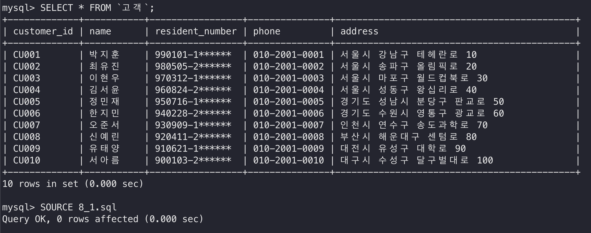
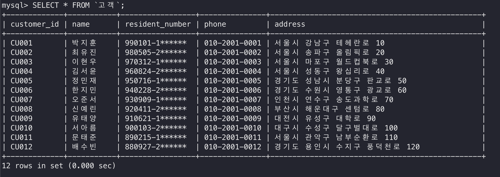

## 8.2) 변경

등록된 고객 정보 중 연락처와 주소를 변경하는 스크립트이다.

```sql
UPDATE `고객`
SET phone = '010-3001-0011',
    address = '서울시 관악구 신림로 210'
WHERE customer_id = 'CU011';

UPDATE `고객`
SET phone = '010-3001-0012',
    address = '경기도 용인시 기흥구 구성로 220'
WHERE customer_id = 'CU012';
```

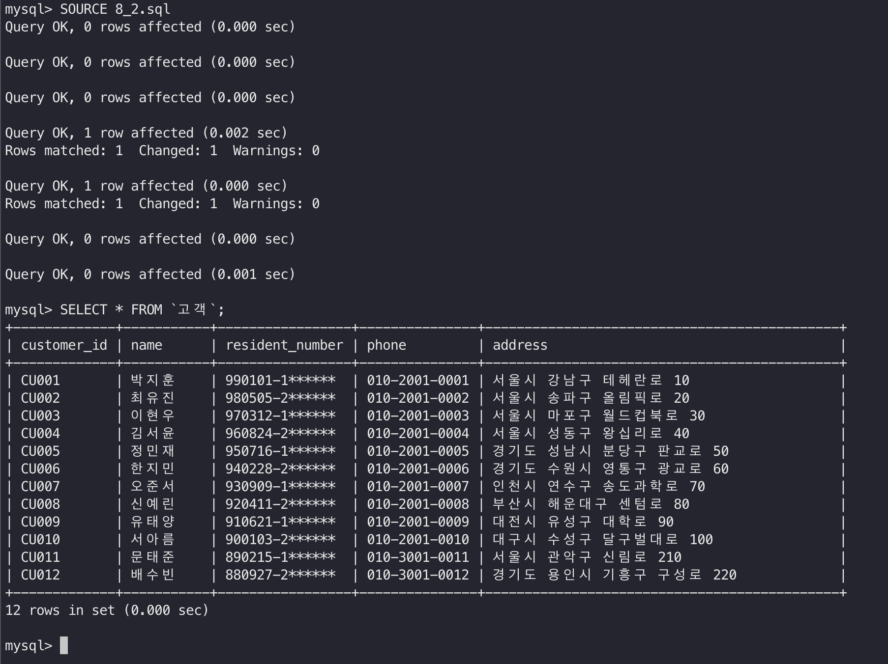

## 8.3) 삭제

등록된 고객 정보를 삭제하는 스크립트이다.

```sql
DELETE FROM `고객`
WHERE customer_id = 'CU011';

DELETE FROM `고객`
WHERE customer_id = 'CU012';
```

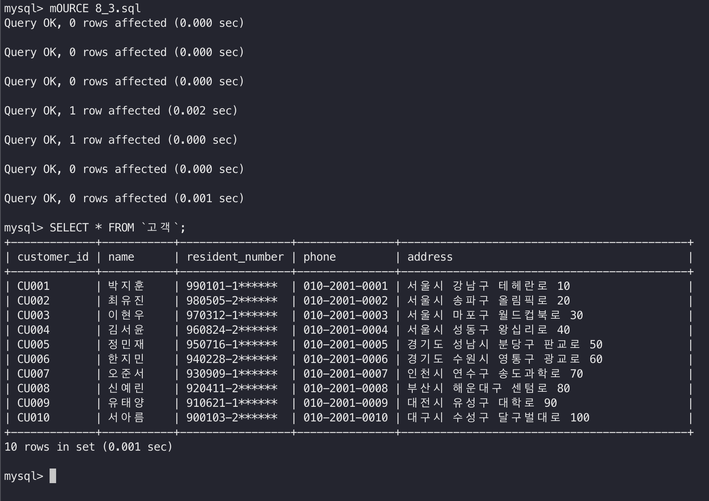

## 8.4) 검색

아래 검색문은 테이블 생성과 데이터 삽입 후 실행한다.

### 1. 검색 제한: 판매중 차량 중 판매가가 높은 차량 5건 조회

```sql
SELECT vehicle_id AS 차량식별번호,
       license_plate AS 차량번호,
       model_name AS 모델명,
       model_year AS 연식,
       sale_price AS 판매가
FROM `차량`
WHERE vehicle_status = '판매중'
ORDER BY sale_price DESC
LIMIT 5;
```

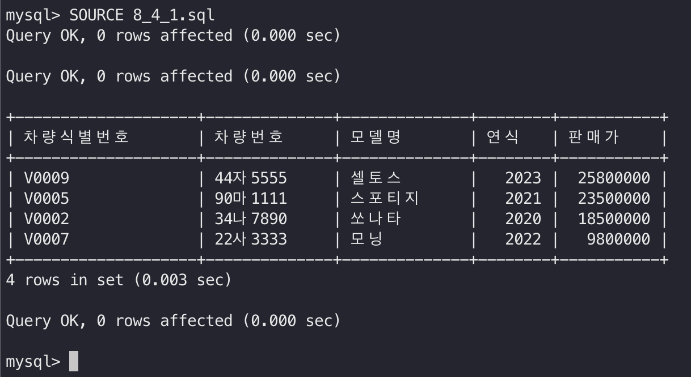

### 2. 그룹 함수: 차량 상태별 차량 수와 평균 판매가 조회

```sql
SELECT vehicle_status AS 차량상태,
       COUNT(*) AS 차량수,
       ROUND(AVG(sale_price), 0) AS 평균판매가
FROM `차량`
GROUP BY vehicle_status
ORDER BY COUNT(*) DESC;
```

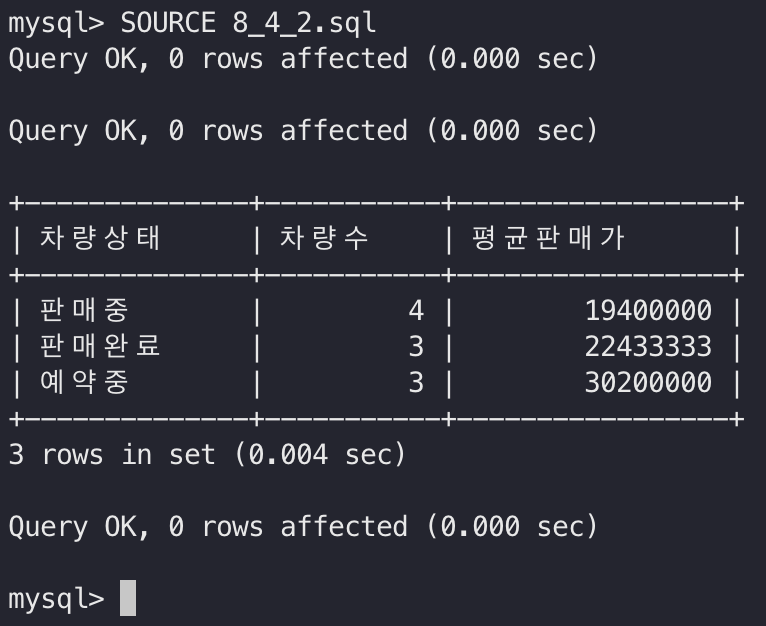

### 3. 테이블 조인: 계약별 고객, 차량, 담당 직원 정보 조회

```sql
SELECT sc.contract_id AS 계약번호,
       c.name AS 고객명,
       v.model_name AS 차량모델,
       e.name AS 담당직원,
       sc.contract_date AS 계약일,
       sc.contract_amount AS 계약금액,
       sc.reservation_status AS 예약상태
FROM `판매계약` sc
JOIN `고객` c ON sc.customer_id = c.customer_id
JOIN `차량` v ON sc.vehicle_id = v.vehicle_id
JOIN `직원` e ON sc.employee_id = e.employee_id
ORDER BY sc.contract_date DESC;
```

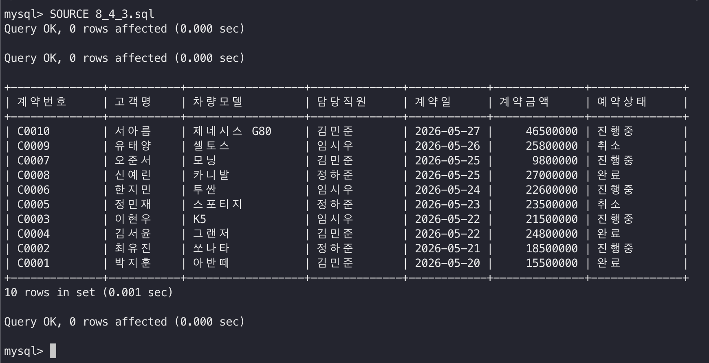

### 4. 서브쿼리: 평균 판매가보다 높은 차량 조회

```sql
SELECT vehicle_id AS 차량식별번호,
       model_name AS 모델명,
       sale_price AS 판매가
FROM `차량`
WHERE sale_price > (
    SELECT AVG(sale_price)
    FROM `차량`
)
ORDER BY sale_price DESC;
```

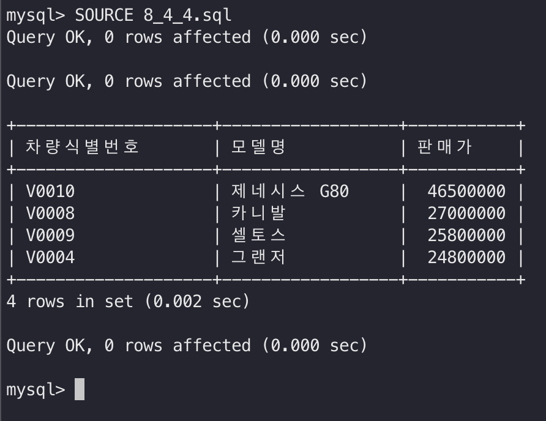

### 5. 그룹 함수와 HAVING: 계약 건수가 2건 이상인 판매 담당자 조회

```sql
SELECT e.employee_id AS 직원번호,
       e.name AS 직원명,
       COUNT(sc.contract_id) AS 계약건수,
       SUM(sc.contract_amount) AS 총계약금액
FROM `직원` e
JOIN `판매계약` sc ON e.employee_id = sc.employee_id
WHERE e.role = '판매 담당자'
GROUP BY e.employee_id, e.name
HAVING COUNT(sc.contract_id) >= 2
ORDER BY 총계약금액 DESC;
```

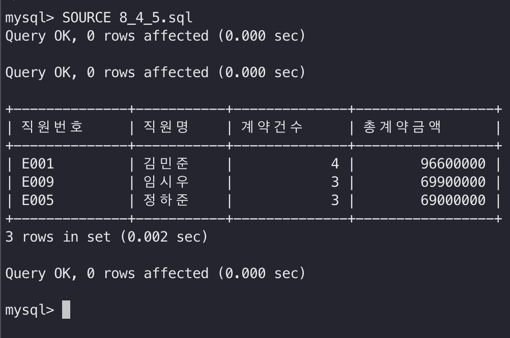

# 9) 팀 구성 보고서
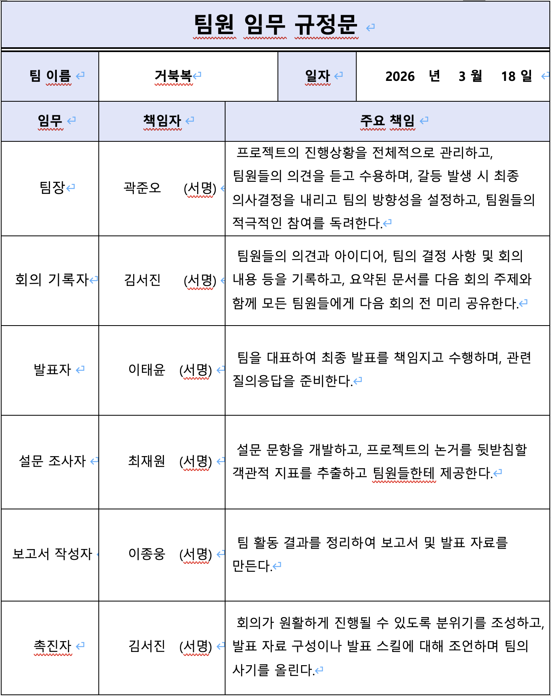
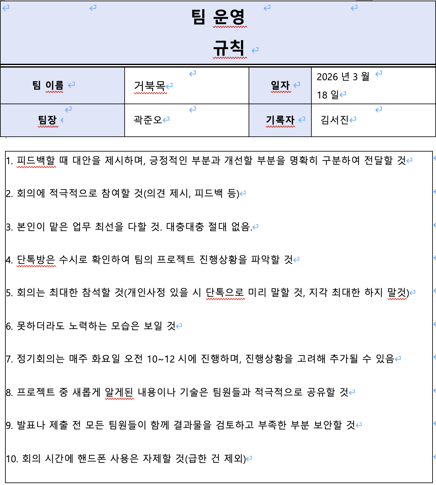

# 10) 팀 프로젝트 수행 소감
## 곽준오(팀장)

## 김서진

## 이종웅

## 이태윤
이번 조별과제를 통해 데이터베이스 설계는 단순히 테이블을 만드는 것이 아니라 업무에 필요한 정보를 분석하고 관계를 체계적으로 정리하는 과정임을 배웠다. 중고차 판매 시스템을 설계하면서 차량·판매·고객·정비·사후관리 등 업무 영역을 구분하고, 직원 개체를 통합하는 방식과 제약조건 설정을 통해 데이터 중복을 줄이고 일관성을 유지하는 중요성을 이해했다. 또한 물리적 설계 과정에서 테이블 구조, 데이터 타입, 키 제약조건, 인덱스 등을 구체화하며 실제 데이터베이스 구현 과정을 경험했다. 조별과제를 수행하면서 역할 분담과 자료 통일 등 협업의 중요성도 느꼈으며, 요구분석부터 정규화와 물리적 설계까지 데이터베이스 설계의 전체 흐름을 이해하는 계기가 되었다.

## 최재원
