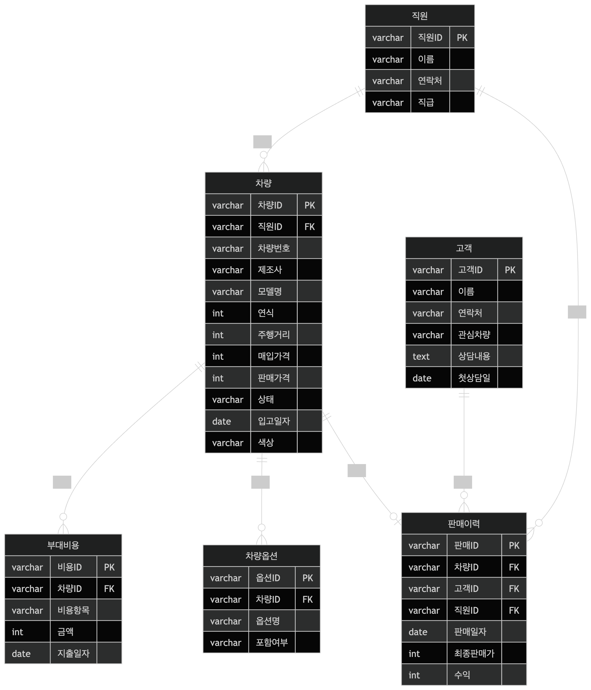

# 피터 첸(Peter Chen) 표기법 vs IE(Information Engineering) 표기법 비교

데이터베이스 설계 시 사용하는 개체-관계 모델(ER 모델)의 대표적인 두 가지 표기법인 피터 첸 표기법과 IE(Information Engineering, 일명 까마귀 발) 표기법을 비교 정리하였습니다.

---

## 1. 주요 구성 요소 비교

| 구분 | 피터 첸(Peter Chen) 표기법 | IE 표기법 (Crow's Foot) |
| :--- | :--- | :--- |
| **주 사용처** | 학술적 개념 모델링, 설계 초기 단계 | 실무 데이터베이스 설계 및 물리 구현 |
| **개체 (Entity)** | 직사각형 | 직사각형 (내부에 속성 리스트 포함) |
| **속성 (Attribute)** | **타원** (개체와 실선으로 연결) | 개체 **상자 내부에 텍스트**로 나열 |
| **관계 (Relationship)** | **마름모** 기호 내부에 관계명 기입 | 개체 간 **선(Line)**으로 직접 연결 |
| **기본키 (PK)** | 속성 타원 내 텍스트에 **밑줄** | 속성명 옆에 **'PK'** 표시 또는 상단 배치 |

---

## 2. 관계 및 대응수(Cardinality) 표현 방식

두 표기법의 가장 큰 차이는 관계의 수(1:1, 1:N, M:N)와 참여 제약 조건을 표현하는 방식에 있습니다.

### 피터 첸 표기법 (숫자 및 기호 중심)
- 관계 선 위에 **1, N, M** 등의 숫자/문자를 직접 기입하여 차수를 나타냅니다.
- **전체 참여(Mandatory):** 개체와 관계 사이를 **이중선**으로 표시합니다.
- **부분 참여(Optional):** 개체와 관계 사이를 **단일선**으로 표시합니다.

### IE 표기법 (도형 기호 중심)
선 끝의 기호 조합을 통해 대응수와 선택성(Optionality)을 동시에 표현합니다.
- **`|` (Mandatory/One):** 실선 한 개는 '1' 또는 '필수'를 의미합니다.
- **`○` (Optional):** 원 모양은 '0' 또는 '선택'을 의미합니다.
- **`∈` (Many):** 세 갈래로 갈라진 모양(까마귀 발)은 '다수(N)'를 의미합니다.
- **조합 예시:**
    - `|` + `|` : 정확히 1개 (1:1 필수)
    - `○` + `∈` : 0개 또는 여러 개 (1:N 선택)
    - `|` + `∈` : 1개 이상 (1:N 필수)

---

## 3. 특징 및 장단점 분석

### 피터 첸 표기법 (Peter Chen Notation)
- **장점:** 개체, 속성, 관계가 명확히 구분되어 데이터 구조를 직관적으로 이해하기 좋습니다. 관계명을 마름모 안에 적으므로 비즈니스 로직 설명에 유리합니다.
- **단점:** 속성이 많아질수록 다이어그램이 매우 거대해지고 복잡해집니다. 공간 효율성이 낮아 대규모 실무 프로젝트에서는 거의 사용되지 않습니다.

### IE 표기법 (Information Engineering Notation)
- **장점:** 속성이 엔티티 박스 안에 포함되어 공간 효율성이 매우 뛰어납니다. 실제 물리적 테이블 구조와 매칭하기 쉬워 현대의 DB 설계 도구(ERwin, MySQL Workbench 등)에서 표준으로 사용됩니다.
- **단점:** 관계의 의미(동사)를 표현하는 기능이 피터 첸 표기법에 비해 다소 약할 수 있습니다.

---

## 4. 참고 이미지

### 피터 첸 표기법 예시

### IE 표기법 예시

