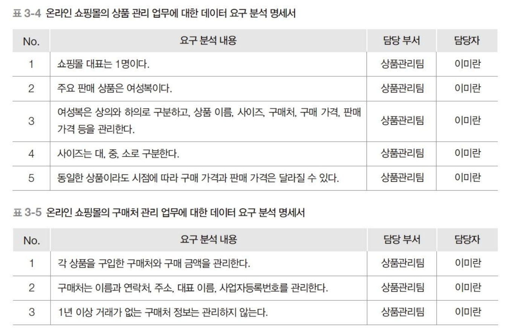

# 데이터 요구 분석 명세서
요구되는 데이터를 분석하여 결과를 문서화

## 작성 시 유의 사항(암기)
1. 단순한 표준 문체를 사용한다.
2. 애매모호한 표현은 피하도록 한다.
   - 예: "교무처에서 수강신청 업무를 담당한다." -> "교무처 학사팀의 수업지원 담당자가 수강신청 업무를 담당한다."
3. 추상화 수준에 맞는 적절한 표현을 사용한다.
   - 예: 은행 지점 위치 구분: 상세주소(X), 천안(X), 서울(X), 쌍용2동(O), 종로2가(O)
   - 추상화: 불필요한 부분은 생략하고 가장 중요한 부분만 추출하는 것을 의미함
4. 지나치게 전문적인 용어보다는 일반적인 용어를 사용한다.
5. 용어 간의 참조가 명확하도록 작성한다.
   - 예: "휴대폰으로 합격 여부를 통보한다." -> "휴대폰 문자로 합격 여부를 통보한다."
6. 가능하면 주어, 목적어, 서술어(동사)가 분명하도록 작성한다.
7. 이음동의어와 동음이의어 표현을 점검한다.
8. DB 구축 프로젝트와 관련된 용어 사전 또는 자료 사전을 만들어서 사용한다.

## 데이터 요구 분석 명세서 예시
