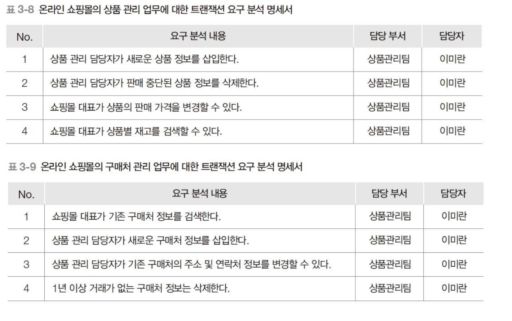

# 트랜잭션 요구 분석 명세서
업무별로 요구되는 트랜잭션을 문서화한것.

> 트랜잭션:
> 데이터 조작 작업.

## 작성 시 유의 사항(암기x)
1. 분할된 업무 영역별로 요구되는 데이터 조작 작업을 간단히 표현한다.
2. 한 번에 하나의 데이터 조작만 포함하도록 작성한다.
3. 데이터 조작 작업은 가능한 검색, 삽입, 삭제, 변경(갱신)이라는 용어를 사용해서 표현한다.
4. 추후 DB와 연동하는 응용 프로그램을 작성할 때 참조가 되도록 데이터 조작 작업의 주체가 누구인지를 명확하게 작성한다.
   - 예: "신규 도서 정보를 삽입한다." -> "수서 담당자가 신규 도서 정보를 삽입한다."

## 트랜잭션 요구 분석 명세서 예시
