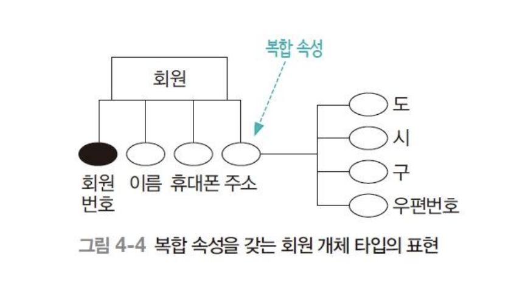
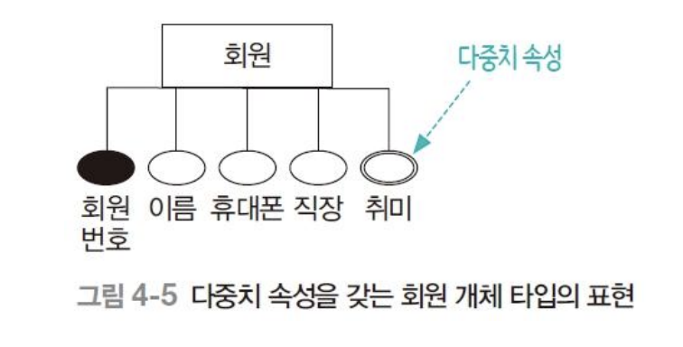
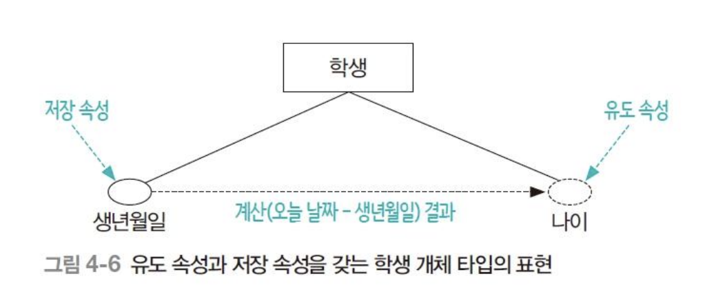
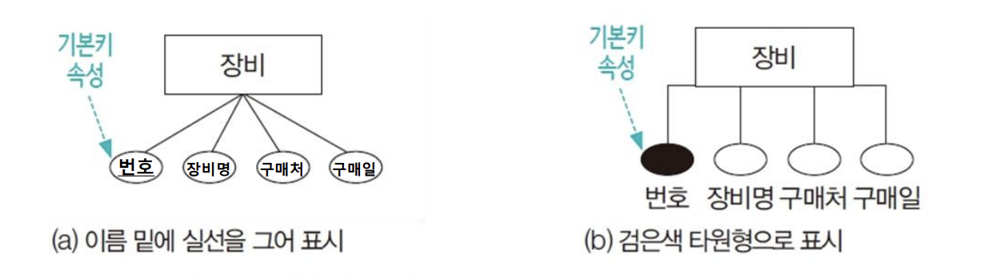

# 속성

## 속성 개념

## 상수 속성, 시변 속성
* 상수속성: 주민등록번호 속성처럼 시간이 지나도 변하지 않는 속성.
* 시변속성: 휴대폰번호속성처럼 시간이 지남에 따라 값이 변할 수 있는 속성.

## 단일속성, 복합속성
* 단일속성: 더 이상 쪼개지지 않음.
* 복합속성: 단순속성들로 분해할 수 있는 속성.

## 단일치 속성, 다중치 속성
* 단일치 속성: 단 하나의 값만 갖는 속성.
* 다중치 속성: 여러개의 값을 가질 수 있는 속성.

## 유도 속성, 저장 속성
* 유도 속성: 다른 값으로 부터 유도되어 결정되는 속성.
* 저장 속성: 유도속성을 결정하기 위해 사용된 속성.

## 널 속성
널 값을 가질 수 있는 속성.

## 기본키 속성, 부분키 속성
* 기본키: 각 개체 인스턴스들을 유일하게 식별할 수 있는 속성 또는 속성들의 집합.
* 부분키: 약한개체의 부분석인 식별자.

