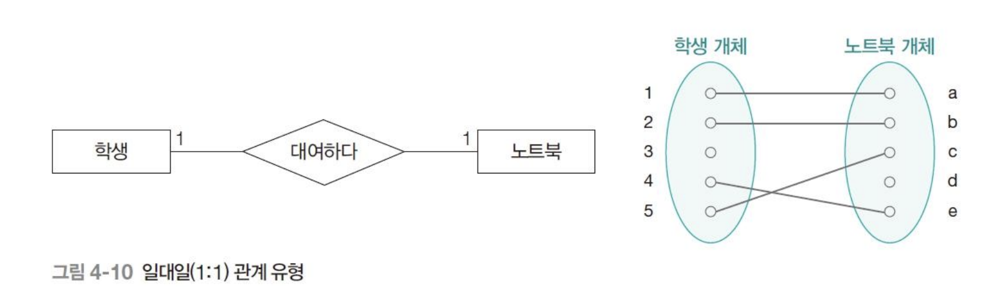
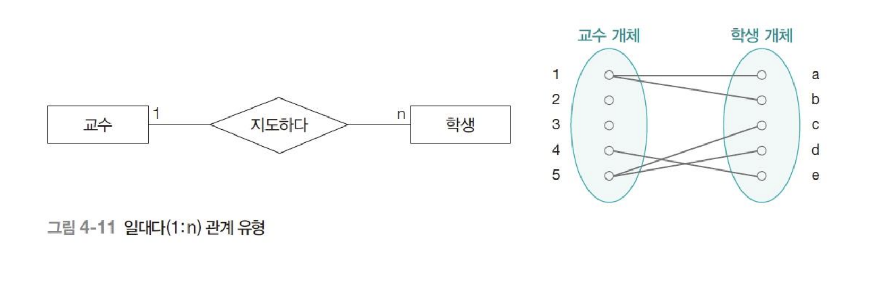
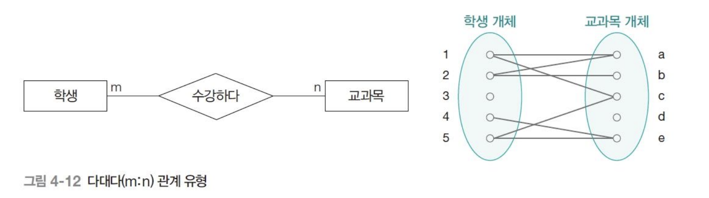

# 관계

## 관계 유형
### 1:1
A개체 인스턴스 하나와 B개체 인스턴스 하나와만 연관성이 있는 유형.

전체참여: 모든 속성이 관계에 참여.
부분참여: 부분적으로만 관계에 참여.

### 1:N or N:1
한 개체 기준으로 여러 인스턴스가 연관성이 있고, 나머지 한 개체 기준으로는 하나뿐인 인스턴스가 연관성이 있는 것.

### M:N
어느 개체 기준으로 보더라고 여러 인스턴스 들이 연관성이 있는것.

