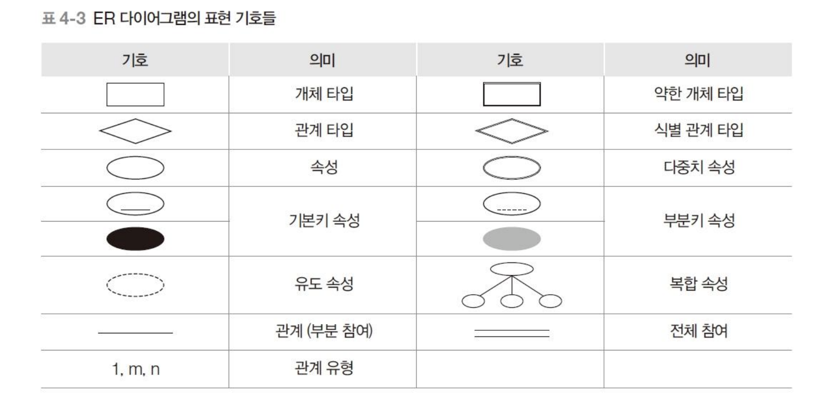
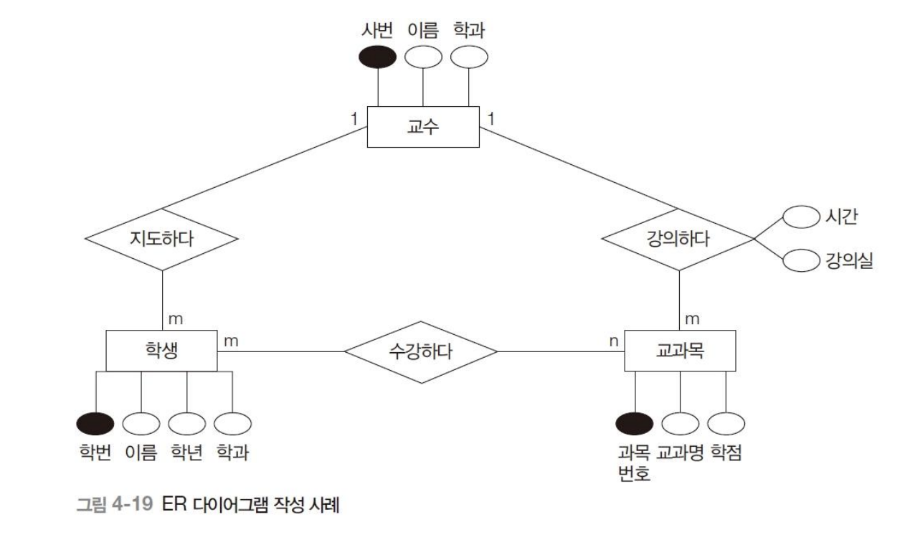

# ER 다이어그램
## 개념
\- 피터첸이 만듦.
\- 개념적 데이터 모델인 ER 모델을 표현하는 방법.

## ER 다이어그램 특징
1. M:N 관계를 표현할 수 있다.
2. 다원 관계를 표현할 수 있다.
   - 3진 관계처럼 3개의 개체 타입이 하나의 관계에 연관된 것을 표현할 수 있다.
3. 다중 관계를 표현할 수 있다.
   - 두 개체 타입 사이에 둘 이상의 관계가 존재하는 것을 표현할 수 있다.
4. 관계 타입을 설명하는 속성을 쉽게 표현할 수 있다.

## ER 다이어그램 작성 시 유의 사항
1. 개체 타입은 반드시 기본키 속성을 포함해야 한다.
2. 기본키 속성 외에 개체 타입을 직접적으로 설명하는 속성도 표현한다.
3. 코드 개체를 제외한 모든 개체 타입은 독자적으로 존재할 수 없다.
4. 관계 타입은 독자적으로 존재할 수 없다.
5. 기본키 속성(또는 속성 집합)은 실선으로 밑줄을 표시한다.

## ER 다이어그램 표현 기호

## ER 다이어그램 예시
